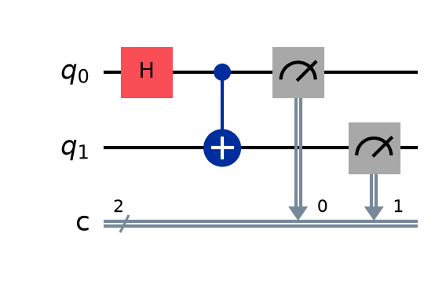
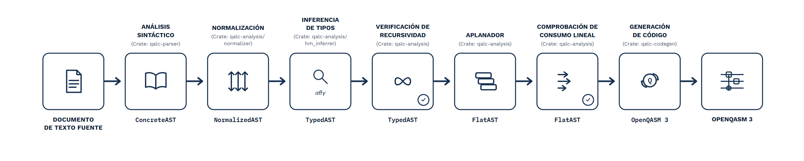
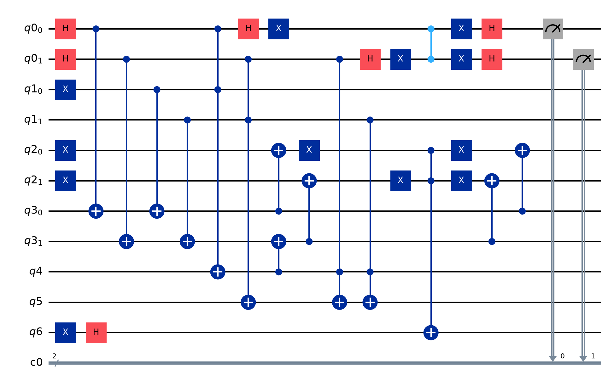

# Qalc: un lenguaje funcional para computación cuántica</h2>

> Versión en Markdown de la memoria original, equivalente al PDF [`memoria.pdf`](memoria.pdf). Las figuras están en [`assets/`](assets/). La numeración de capítulos, secciones, figuras, tablas y códigos es la del PDF; el índice general se reproduce sin números de página.

---

## Certificado

D. **Daniel Escanez-Exposito**, miembro del grupo de investigación en criptología de la Universidad de La Laguna, CryptULL, como tutor.

Dña **Pino Caballero-Gil**, Catedrática de Universidad adscrita al Departamento de Ingeniería Informática y de Sistemas de la Universidad de La Laguna, como cotutora.

**C E R T I F I C A N**

Que la presente memoria titulada:

> *"Qalc: un lenguaje funcional para computación cuántica"*

ha sido realizada bajo su dirección por D. **Guillermo Silva González**.

Y para que así conste, en cumplimiento de la legislación vigente y a los efectos oportunos, firman la presente en La Laguna a 20 de noviembre de 2026.

---

## Agradecimientos

A mi tutor, Daniel, por su guía a lo largo de este trabajo; sin su experiencia en el diseño de algoritmos cuánticos, el diseño de este lenguaje no habría sido posible.

A mis padres, por su apoyo durante toda mi formación.

A mis amigos, Gabriel, Hugo, Sergio, Adrián y Roberto, por acompañarme durante toda mi etapa universitaria.

---

## Licencia

<p align="center">
  <br>
  © Esta obra está bajo una licencia de Creative Commons Reconocimiento-CompartirIgual 4.0 Internacional.
</p>

---

## Resumen

La programación cuántica actual está dominada por herramientas que operan al nivel del circuito, en las que el programador ensambla explícitamente puertas lógicas sobre cúbits individuales sin ninguna garantía formal sobre la corrección física del resultado. Bibliotecas de amplia adopción industrial como Qiskit o Cirq, al estar embebidas en un lenguaje clásico de tipado dinámico, no pueden verificar en tiempo de compilación restricciones fundamentales de la mecánica cuántica, como el teorema de no clonación o la correcta descomputación de los cúbits auxiliares; los errores derivados de su incumplimiento solo se manifiestan en tiempo de ejecución física, con un coste de diagnóstico elevado. Las propuestas académicas más rigurosas, como Silq, Guppy o Twist, incorporan alguna forma de análisis estático sobre estas restricciones, pero ninguna combina un sistema de tipos lineales completo con una salida hacia un formato estándar e interoperable con hardware de múltiples fabricantes.

Este trabajo presenta Qalc, un lenguaje de programación funcional con tipado estático fuerte orientado a la descripción de circuitos cuánticos, junto con la implementación de su compilador en Rust. El sistema de tipos de Qalc combina la inferencia de tipos de Hindley-Milner con una disciplina de tipos lineales que obliga a que cada recurso cuántico se consuma exactamente una vez a lo largo del programa, haciendo imposible en tiempo de compilación tanto la clonación accidental como la fuga de cúbits sin liberar. El modelo de cómputo del lenguaje es deliberadamente no recursivo, en correspondencia directa con la naturaleza finita y estática de los circuitos cuánticos ejecutables sobre hardware NISQ (del inglés *Noisy Intermediate-Scale Quantum*), y expresa la repetición de patrones mediante combinadores de orden superior que el compilador expande en tiempo de compilación.

El compilador se estructura como un pipeline de fases independientes, desde el análisis léxico y sintáctico hasta la generación de código, pasando por la normalización, la inferencia de tipos, la verificación de recursividad, un aplanador que reduce el programa a una única expresión sin abstracción funcional pendiente, una comprobación de consumo lineal y, finalmente, la generación de código hacia OpenQASM 3 (del inglés *Open Quantum Assembly Language*), el estándar abierto adoptado por los principales proveedores de hardware cuántico. El resultado de este trabajo es un prototipo funcional en el que el frontend del compilador, hasta la inferencia de tipos, está completamente implementado, mientras que las fases del backend se encuentran en un estado experimental suficiente para demostrar el funcionamiento completo del pipeline.

**Palabras clave:** Computación cuántica, Lenguajes de programación, Tipos lineales, Inferencia de tipos Hindley-Milner, OpenQASM, Compiladores

---

## Abstract

*Quantum programming today is dominated by tools that operate at the circuit level, where the programmer explicitly assembles logic gates over individual qubits with no formal guarantee about the physical correctness of the result. Widely adopted industrial libraries such as Qiskit or Cirq, being embedded in a dynamically typed classical language, cannot verify fundamental constraints of quantum mechanics at compile time, such as the no-cloning theorem or the correct uncomputation of ancilla qubits; errors arising from violating these constraints only surface at physical runtime, at a high diagnostic cost. The most rigorous academic proposals, such as Silq, Guppy or Twist, incorporate some form of static analysis over these constraints, but none combines a full linear type system with output to a standard, interoperable format supported by multiple hardware vendors.*

*This work presents Qalc, a statically and strongly typed functional programming language for describing quantum circuits, together with the implementation of its compiler in Rust. The type system of Qalc combines Hindley-Milner type inference with a linear type discipline that forces every quantum resource to be consumed exactly once throughout the program, making both accidental cloning and unreleased qubit leaks impossible to express at compile time. The computation model of the language is deliberately non-recursive, directly mirroring the finite, static nature of quantum circuits executable on NISQ (Noisy Intermediate-Scale Quantum) hardware, and expresses repeated patterns through higher-order combinators that the compiler unrolls at compile time.*

*The compiler is structured as a pipeline of independent phases, from lexical and syntax analysis to code generation, passing through normalization, type inference, recursion verification, a flattener that reduces the program to a single expression free of pending functional abstraction, a linear consumption check, and finally code generation targeting OpenQASM 3 (Open Quantum Assembly Language), the open standard adopted by the main quantum hardware providers. The result of this work is a functional prototype in which the compiler frontend, up to type inference, is fully implemented, while the backend phases remain at an experimental stage sufficient to demonstrate the complete pipeline.*

***Keywords:** Quantum computing, Programming languages, Linear types, Hindley-Milner type inference, OpenQASM, Compilers*

---

## Índice general

- Índice de códigos
- **Capítulo 1. Introducción y estado del arte**
  - 1.1. Motivación del trabajo
  - 1.2. Fundamentos de computación cuántica
    - 1.2.1. Cúbit y superposición
    - 1.2.2. Entrelazamiento cuántico
    - 1.2.3. Circuitos cuánticos
    - 1.2.4. Medición y decoherencia
    - 1.2.5. Teorema de no clonación
    - 1.2.6. Cúbits auxiliares y descomputación
    - 1.2.7. Interferencia cuántica
  - 1.3. Lenguajes de programación cuántica existentes
    - 1.3.1. Lenguajes imperativos de alto nivel
    - 1.3.2. Entornos basados en bibliotecas
    - 1.3.3. Lenguajes funcionales y formales
    - 1.3.4. Análisis comparativo
  - 1.4. Contexto tecnológico y propuesta de Qalc
  - 1.5. Alcance del proyecto
  - 1.6. Estructura de la memoria
- **Capítulo 2. Diseño del lenguaje y especificación**
  - 2.1. Principios de diseño del lenguaje
  - 2.2. El cúbit como recurso lineal
    - 2.2.1. Problema del aliasing y no clonación
    - 2.2.2. Variables cuánticas como circuitos en construcción
  - 2.3. Sistema de tipos
  - 2.4. Léxico y estructura de un programa
    - 2.4.1. Estructura general
    - 2.4.2. Espacios en blanco y comentarios
    - 2.4.3. Identificadores y palabras clave
    - 2.4.4. Operadores
  - 2.5. Expresiones y control de flujo
    - 2.5.1. Aplicación, lambdas y aplicación parcial
    - 2.5.2. Tuberías y aplicación explícita
    - 2.5.3. Bloques monádicos
  - 2.6. Operaciones cuánticas y composición de circuitos
    - 2.6.1. Operaciones sobre datos cuánticos en el nivel alto
    - 2.6.2. El tipo `qcirc` en el nivel bajo
- **Capítulo 3. Arquitectura del compilador**
  - 3.1. Stack tecnológico
  - 3.2. Organización en crates
  - 3.3. Visión general del pipeline
  - 3.4. El rasgo `CompilerStep` y la composición de fases
  - 3.5. El patrón AST paramétrico
  - 3.6. Análisis sintáctico
  - 3.7. Normalización
  - 3.8. Verificador de recursividad
- **Capítulo 4. Análisis semántico y sistema de tipos**
  - 4.1. Ámbito léxico y declaraciones de nivel superior
  - 4.2. El algoritmo de Hindley-Milner
  - 4.3. Representación de tipos durante la inferencia
  - 4.4. Generación de restricciones de tipo
  - 4.5. Unificación
  - 4.6. Aplicación de la sustitución
  - 4.7. Sobrecarga de funciones discriminada por tipo
  - 4.8. Casos de uso
    - 4.8.1. Inferencia sobre una operación cuántica compuesta
    - 4.8.2. Resolución de sobrecarga en una llamada concreta
    - 4.8.3. Detección de un error de tipos en tiempo de compilación
- **Capítulo 5. Backend del compilador**
  - 5.1. Aplanador
  - 5.2. Comprobación de consumo único de recursos lineales
  - 5.3. Generación de código
    - 5.3.1. Punto de entrada del programa
    - 5.3.2. Arquitectura del emisor
    - 5.3.3. El rasgo `Transpilable` y la separación de registros de built-ins
    - 5.3.4. Ensamblado final y promoción de salidas
    - 5.3.5. Iteración genérica con `repeat`
- **Capítulo 6. Demostración de búsqueda con el algoritmo de Grover**
  - 6.1. Planteamiento del problema de búsqueda
  - 6.2. Aritmética reversible
  - 6.3. Comparador y kickback de fase
  - 6.4. Oráculo y difusor
  - 6.5. Punto de entrada y despliegue con `repeat`
  - 6.6. Resultado de la compilación
  - 6.7. Hacia una biblioteca estándar de funciones cuánticas
- **Capítulo 7. Conclusiones y líneas futuras**
  - 7.1. Conclusiones
  - 7.2. Líneas futuras
- **Capítulo 8. Summary and Conclusions**
  - 8.1. Conclusions
  - 8.2. Future work
- **Capítulo 9. Presupuesto**
  - 9.1. Recursos y herramientas
  - 9.2. Mano de obra
  - 9.3. Coste total
- **Apéndice A. Gramática del lenguaje en notación EBNF**
  - A.1. Convenciones de notación
  - A.2. Espacios en blanco y comentarios
  - A.3. Palabras reservadas e identificadores
  - A.4. Literales
  - A.5. Operadores
  - A.6. Expresiones átomo
  - A.7. Expresiones de bloque
  - A.8. Expresiones binarias
  - A.9. Tipos
  - A.10. Declaraciones y producción inicial
- **Apéndice B. Código OpenQASM 3 de la demostración de Grover**
- Bibliografía

## Índice de figuras

- 1.1. Circuito cuántico de dos cúbits que prepara un estado de Bell
- 3.1. Fases del pipeline del compilador de Qalc
- 6.1. Circuito generado para la demostración de búsqueda de Grover

## Índice de tablas

- 1.1. Comparativa de lenguajes o entornos cuánticos
- 2.1. Operadores del lenguaje Qalc agrupados por categoría
- 9.1. Recursos y herramientas
- 9.2. Coste de mano de obra
- 9.3. Resumen del presupuesto del proyecto

## Índice de códigos

- 2.1. Declaración de constantes enteras con distintos sufijos y bases
- 2.2. Declaración de una constante en coma flotante
- 2.3. Declaración de una tupla de dos componentes
- 2.4. Declaración de slices enumerado y por rango
- 2.5. El tipo `bool` como resultado de una comparación
- 2.6. Firma de una función sobre `qbool`
- 2.7. Firma de una función sobre un entero cuántico
- 2.8. Firma de una medición que produce un resultado clásico envuelto en `qio`
- 2.9. Firma y definición de una función de dos argumentos currificada
- 2.10. Violación de no clonación por uso doble de un valor cuántico
- 2.11. Violación de no fuga por descarte implícito de un cúbit
- 2.12. Uso correcto de un valor cuántico lineal
- 2.13. Valor clásico sin restricciones de linealidad
- 2.14. Estructura genérica de un bloque monádico
- 2.15. Operaciones cuánticas de alto nivel sobre `qi16`
- 2.16. Firmas de las puertas básicas `H` y `X` sobre `qcirc`
- 2.17. Firma sobrecargada de `at` y ejemplos de aplicación parcial
- 2.18. Firma de `controlled` y ejemplo de puerta CNOT
- 2.19. Circuito de Bell implementado en Qalc
- 3.1. Definición del rasgo `CompilerStep` en Rust
- 3.2. Definición del rasgo `ASTMetadata` en Rust
- 3.3. Desazucarado de llamadas a función con múltiples argumentos
- 3.4. Desazucarado de deconstrucción de tupla en parámetros
- 4.1. Definición del tipo `Scope` para el ámbito léxico
- 4.2. Ejemplo de declaración a inferir mediante Hindley-Milner
- 4.3. Ejemplo de sobrecarga de función discriminada por tipo del primer parámetro
- 4.4. Declaración que combina un bloque `let` y una tupla sobre valores cuánticos
- 4.5. Dos llamadas a la función sobrecargada `at` resueltas con distinta firma
- 4.6. Declaración que produce un error de unificación entre `qbool` e `i32`
- 5.1. Clasificación de una aplicación antes de aplanarla
- 5.2. Ligadura de argumentos tras alfa-renombrar los parámetros
- 5.3. Comprobación de que los parámetros y el resultado de `main` son clásicos
- 5.4. Estado mutable del emisor durante la generación de código
- 5.5. Firmas `Backend` y `Transpilable` y su implementación para OpenQASM 3
- 5.6. Intercepción de `repeat` antes de la evaluación genérica de argumentos
- 6.1. Firma y preparación de recursos del sumador ripple-carry
- 6.2. Preparación del ancilla de fase del comparador de igualdad
- 6.3. Oráculo que compone la suma y la comparación de igualdad
- 6.4. Difusor de Grover sobre el registro de búsqueda
- 6.5. Iteración de Grover parametrizada por el número de rondas y el oráculo
- 6.6. Fragmento del sumador ripple-carry en el OpenQASM 3 emitido
- A.1. Clases de caracteres auxiliares
- A.2. Reglas de espacios en blanco y comentarios
- A.3. Reglas de palabras reservadas e identificadores
- A.4. Reglas de literales numéricos
- A.5. Reglas de operadores
- A.6. Reglas de las expresiones átomo
- A.7. Reglas de las expresiones de bloque
- A.8. Reglas de las expresiones binarias
- A.9. Reglas del sistema de tipos
- A.10. Reglas de declaraciones y producción inicial
- B.1. Salida OpenQASM 3 completa de la demostración de Grover

---

# Capítulo 1. Introducción y estado del arte

La computación cuántica lleva décadas prometiendo resolver problemas que escapan a la capacidad de cualquier ordenador clásico, desde la simulación de sistemas moleculares complejos hasta la búsqueda en espacios de soluciones de escala exponencial. Sin embargo, programar estas máquinas sigue siendo hoy una tarea reservada a especialistas con formación profunda en física cuántica, no porque los algoritmos sean inherentemente incomprensibles, sino porque las herramientas disponibles obligan al desarrollador a razonar al nivel del hardware. Este trabajo de fin de grado nace de esa distancia entre lo que la computación cuántica puede hacer y lo que un ingeniero de software puede expresar con las herramientas actuales.

## 1.1. Motivación del trabajo

El ecosistema actual de programación cuántica está dominado por herramientas que operan al nivel del circuito cuántico, donde el desarrollador construye su algoritmo ensamblando explícitamente puertas lógicas sobre cúbits individuales. Este modelo tiene sentido como representación de bajo nivel para el hardware, pero resulta inadecuado como abstracción de programación para cualquier algoritmo de complejidad moderada.

Los entornos más extendidos, como Qiskit [1] (IBM) o Cirq [2] (Google), se presentan como bibliotecas Python que construyen circuitos de este modo. Su principal limitación no es la falta de funcionalidades, sino la ausencia total de garantías estáticas sobre la corrección física del código. Al ser bibliotecas de un lenguaje clásico de tipado dinámico, no pueden verificar en tiempo de compilación reglas fundamentales de la mecánica cuántica. El teorema de no clonación [3] prohíbe duplicar el estado de un cúbit arbitrario, pero nada en Python impide que un programador asigne la misma variable cuántica a dos operaciones simultáneas; el error solo aparecerá en tiempo de ejecución, a menudo en forma de resultados silenciosamente incorrectos. La gestión manual de la topología del chip, la secuencia de pulsos o el ciclo de vida de cada cúbit traslada al programador una responsabilidad que debería pertenecer al compilador.

El resultado es un ecosistema donde la complejidad accidental supera con frecuencia a la complejidad esencial del problema. Escribir el algoritmo de Grover [4] o la transformada cuántica de Fourier en Qiskit requiere más líneas de código de bajo nivel que de lógica algorítmica, y cualquier refactorización puede introducir errores físicos difíciles de detectar.

## 1.2. Fundamentos de computación cuántica

Antes de analizar los lenguajes de programación cuántica existentes y presentar la propuesta de Qalc, es necesario establecer los conceptos físicos sobre los que se asienta este trabajo. Los principios que se describen a continuación no son solo curiosidades de la mecánica cuántica, sino restricciones que cualquier herramienta de programación cuántica debe respetar, y que determinan directamente las decisiones de diseño que se discuten en los capítulos siguientes.

### 1.2.1. Cúbit y superposición

La unidad fundamental de información en la computación cuántica es el cúbit. A diferencia del bit clásico, que en todo momento tiene un valor concreto (0 o 1), el cúbit puede estar en una superposición de ambos estados a la vez. La forma más sencilla de entender esto es imaginar que el cúbit lleva asociados dos pesos, uno para el estado 0 y otro para el estado 1, que indican con qué probabilidad se obtendrá cada resultado al medirlo.

Formalmente, esos pesos son dos números complejos $\alpha$ y $\beta$, y el estado del cúbit se expresa mediante la notación de Dirac.

$$|\psi\rangle = \alpha|0\rangle + \beta|1\rangle \tag{1.1}$$

*Estado general de un cúbit en superposición*

Esta notación, como se indica en la Ecuación 1.1, es la forma general del estado de un cúbit.

Al medir se obtiene 0 con probabilidad $|\alpha|^2$ y 1 con probabilidad $|\beta|^2$. La única restricción es que las probabilidades deben sumar 1, es decir, $|\alpha|^2 + |\beta|^2 = 1$. La superposición no es una simple ignorancia del valor real, sino una propiedad física que permite explotar los dos estados en paralelo hasta el momento en que se realiza la medición.

Con $n$ cúbits el efecto se multiplica, de modo que un sistema de $n$ cúbits puede representar $2^n$ combinaciones de pesos de forma simultánea, lo que abre la posibilidad de procesar en paralelo espacios de estados de tamaño exponencial con circuitos de profundidad relativamente corta.

### 1.2.2. Entrelazamiento cuántico

Cuando dos o más cúbits interactúan, pueden quedar en un estado conjunto que no puede describirse como el producto de sus estados individuales. Este fenómeno se denomina entrelazamiento. El ejemplo más conocido es el primer estado de Bell.

$$|\Phi^+\rangle = \frac{1}{\sqrt{2}}\left(|00\rangle + |11\rangle\right) \tag{1.2}$$

*Primer estado de Bell*

Este estado, como se indica en la Ecuación 1.2, se lee como 00 y 11 con igual probabilidad. En este estado, ninguno de los dos cúbits tiene un valor propio definido, pero si se mide uno y se obtiene 0, el otro colapsará instantáneamente a 0 también, independientemente de la distancia física entre ellos. El entrelazamiento subyace a algunas de las ventajas computacionales más relevantes de la computación cuántica, entre ellas la teleportación cuántica y la aceleración de ciertos algoritmos de búsqueda y factorización.

Desde el punto de vista del diseño de lenguajes, el entrelazamiento implica que los cúbits no son recursos independientes. Modificar o medir un cúbit puede alterar el estado de cualquier otro con el que esté entrelazado, lo que hace que el análisis estático sobre el estado cuántico sea significativamente más complejo que en la computación clásica.

### 1.2.3. Circuitos cuánticos

El modelo de circuitos cuánticos es la abstracción de cómputo estándar en la programación cuántica. En este modelo, los cúbits se representan como líneas horizontales (cables) y las operaciones sobre ellos como puertas lógicas que actúan en secuencia temporal de izquierda a derecha. A diferencia de las puertas lógicas clásicas, todas las puertas cuánticas son operaciones reversibles, en el sentido de que dado el resultado de aplicar una puerta y el conocimiento de cuál era, siempre se puede recuperar la entrada exacta. Esta reversibilidad no es una elección de diseño sino una consecuencia directa de la física, y significa que el cómputo cuántico (salvo en los pasos de medición) nunca pierde información.

Algunas puertas fundamentales son la puerta Hadamard (H), que lleva un cúbit del estado base $|0\rangle$ a la superposición uniforme $\frac{1}{\sqrt{2}}(|0\rangle + |1\rangle)$; la puerta CNOT (del inglés *Controlled NOT*), que invierte el segundo cúbit si y solo si el primero vale uno, creando entrelazamiento entre ambos; y la puerta de Toffoli, que extiende la lógica clásica reversible a tres cúbits y es la base de la aritmética cuántica. El conjunto formado por las puertas Hadamard, T y CNOT es suficiente para expresar cualquier operación cuántica posible con la precisión deseada, lo que hace de estas tres puertas un juego de construcción completo para cualquier algoritmo.

La Figura 1.1 muestra el circuito más sencillo que ilustra ambas ideas a la vez, una puerta Hadamard sobre el primer cúbit seguida de una puerta CNOT entre ambos, que prepara precisamente el estado de Bell presentado en la Subsección 1.2.2.

<p align="center">
  <br>
  <em>Figura 1.1: Circuito cuántico de dos cúbits que prepara un estado de Bell</em>
</p>

El hardware cuántico actual se enmarca en el paradigma NISQ [5], que designa procesadores con decenas o pocos cientos de cúbits sin corrección de errores cuántica. Esta realidad impone restricciones directas sobre la profundidad de los circuitos que pueden ejecutarse con resultados útiles, y hace que la eficiencia en la generación de código sea un criterio relevante para el compilador.

La conexión con el paradigma funcional es directa. Una puerta cuántica es una función pura que recibe un estado como entrada y devuelve uno nuevo sin efectos laterales. Un circuito cuántico es, en consecuencia, la composición secuencial y paralela de tales funciones, exactamente el modelo que Qalc adopta para la construcción de programas.

### 1.2.4. Medición y decoherencia

Medir un cúbit es la única operación que no puede deshacerse. Al observar el estado de un cúbit en superposición, este instantáneamente devuelve 0 (con probabilidad $|\alpha|^2$) o 1 (con probabilidad $|\beta|^2$). La superposición desaparece en ese instante y, desde ese momento, el cúbit se comporta como un bit clásico ordinario; las amplitudes que tenía antes de la medición se pierden de forma irrecuperable.

Un fenómeno relacionado, la decoherencia, ocurre cuando el cúbit interactúa involuntariamente con su entorno físico (vibraciones térmicas, campos electromagnéticos ambientales, vibraciones mecánicas). Cada interacción no controlada hace que las amplitudes se mezclen con el entorno y el cúbit pierda gradualmente su comportamiento cuántico, degradándose hacia un estado donde ya no hay superposición y los resultados son simplemente probabilísticos al modo clásico. Los cúbits físicos actuales aguantan en superposición entre microsegundos y milisegundos antes de que la decoherencia los degrade, lo que limita severamente la duración de los circuitos ejecutables.

Estas propiedades imponen dos restricciones sobre los lenguajes cuánticos. En primer lugar, el resultado de una medición no puede reutilizarse como estado cuántico, porque la superposición ya ha colapsado. En segundo lugar, la ejecución clásica intercalada dentro de un circuito consume tiempo de coherencia, por lo que los flujos híbridos clásico-cuántico deben concentrarse en puntos específicos del algoritmo.

### 1.2.5. Teorema de no clonación

El teorema de no clonación establece que es imposible copiar el estado de un cúbit arbitrario desconocido sin destruirlo. Intuitivamente, copiar información cuántica implicaría conocerla primero, pero medirla para conocerla destruye la superposición. Formalmente, no existe ninguna operación cuántica $U$ que satisfaga la ecuación 1.3.

$$U\big(|\psi\rangle \otimes |0\rangle\big) = |\psi\rangle \otimes |\psi\rangle, \quad \text{para todo } |\psi\rangle \tag{1.3}$$

*Igualdad que ninguna operación cuántica puede satisfacer (no clonación)*

Esta imposibilidad se formaliza en la Ecuación 1.3. La razón es que todas las operaciones cuánticas (al ser reversibles) deben comportarse de forma lineal, y la copia no es lineal. Si $U$ copiase correctamente $|0\rangle$ y $|1\rangle$ por separado, al aplicarla a $\alpha|0\rangle + \beta|1\rangle$ produciría $\alpha(|00\rangle) + \beta(|11\rangle)$, que es un estado entrelazado diferente de tener dos copias independientes del estado original $(\alpha|0\rangle + \beta|1\rangle) \otimes (\alpha|0\rangle + \beta|1\rangle)$.

Este principio tiene una consecuencia directa en el diseño de lenguajes de programación. Los lenguajes clásicos asumen implícitamente la semántica de copia para sus variables, de forma que leer una variable dos veces produce dos copias independientes del valor. Esta semántica es físicamente imposible para los cúbits. Un lenguaje cuántico sin mecanismos para controlar el uso de cada cúbit permite, sin ningún error de compilación, que una variable cuántica sea pasada a dos operaciones distintas, lo que equivale a intentar clonar su estado. El error solo se manifiesta en tiempo de ejecución física, con consecuencias difícilmente diagnosticables sobre el estado del procesador cuántico (QPU, del inglés *Quantum Processing Unit*).

### 1.2.6. Cúbits auxiliares y descomputación

Muchos algoritmos cuánticos requieren cúbits de trabajo adicionales, denominados cúbits ancilla, para almacenar resultados intermedios durante el cómputo. Una vez que su contenido ya no es necesario, estos cúbits deben ser devueltos al estado base $|0\rangle$ antes de ser liberados.

La razón de este requisito es física. Si un cúbit ancilla ha interactuado con el registro de cómputo principal y se libera sin restaurar, permanece entrelazado con él. Cualquier medición posterior sobre el registro afecta también al ancilla, proyectando el estado global hacia una mezcla estadística y destruyendo la coherencia cuántica del resultado. Este fenómeno se denomina basura cuántica (*quantum garbage*).

La solución es la descomputación, que consiste en aplicar el circuito inverso sobre el ancilla para deshacer todas las operaciones que lo modificaron y devolverlo al estado inicial. Esta operación siempre existe porque, al ser todas las puertas cuánticas reversibles, cualquier circuito tiene un circuito inverso que deshace exactamente lo que el original hizo. Sin embargo, generarla correctamente exige que el compilador conozca el historial completo de operaciones sobre el ancilla, lo que convierte la descomputación en un problema de análisis estático no trivial que diferencia claramente a los lenguajes cuánticos entre sí.

### 1.2.7. Interferencia cuántica

Los pesos (amplitudes) que describen el estado de un cúbit son números complejos, lo que significa que no solo tienen una magnitud sino también una orientación. Cuando dos caminos computacionales convergen en el mismo estado, sus amplitudes se combinan de tal forma que, si apuntan en la misma dirección, se refuerzan mutuamente (interferencia constructiva), y si apuntan en direcciones opuestas, se cancelan (interferencia destructiva), de forma análoga a cómo dos ondas sonoras pueden amplificarse mutuamente o silenciarse al encontrarse.

Los algoritmos cuánticos explotan este mecanismo para diseñar circuitos en los que las trayectorias que conducen a respuestas incorrectas interfieren destructivamente, reduciendo su probabilidad hasta hacerla negligible, mientras que las trayectorias que conducen a la respuesta correcta interfieren constructivamente, amplificando su amplitud. El algoritmo de búsqueda de Grover, por ejemplo, consigue que la probabilidad de medir la solución correcta crezca cuadráticamente con cada iteración del operador de amplificación.

El orden y la elección de las puertas cuánticas en un circuito determinan el patrón de interferencia y, en última instancia, la corrección del algoritmo. Esta dependencia refuerza la necesidad de una representación formal del circuito que preserve el orden de las operaciones y haga imposible la reordenación accidental de puertas, algo que la construcción funcional de Qalc garantiza por diseño.

Los principios descritos en los apartados anteriores no son solo fenómenos físicos, sino restricciones que cualquier lenguaje de programación cuántica debe respetar para que los programas que genera sean físicamente ejecutables y correctos. La imposibilidad de clonar un estado cuántico se traduce en un requisito de unicidad en el sistema de tipos. La irreversibilidad de la medición exige separar el cómputo cuántico puro de la interacción con el entorno. La necesidad de descomputar los cúbits auxiliares convierte el ciclo de vida de los recursos en un problema central del compilador. La interferencia cuántica impone que el orden de las operaciones sea parte esencial de la semántica del programa. La Sección 1.3 evalúa en qué medida los lenguajes existentes han incorporado estas restricciones en su diseño.

## 1.3. Lenguajes de programación cuántica existentes

El rápido crecimiento del hardware cuántico durante la última década ha estimulado una proliferación paralela de lenguajes y entornos de programación cuántica. Sin embargo, este ecosistema presenta una fractura evidente, pues mientras los entornos dominantes de la industria ofrecen amplio soporte de hardware pero carecen de seguridad formal, las propuestas académicas más rigurosas adolecen de adopción limitada, rigidez semántica o rendimiento clásico insuficiente para escenarios de producción. Las subsecciones siguientes clasifican los actores principales por paradigma y los evalúan sobre los fundamentos físicos introducidos en la Sección 1.2.

### 1.3.1. Lenguajes imperativos de alto nivel

Los lenguajes imperativos estructuran los programas como secuencias de operaciones que modifican un estado híbrido clásico-cuántico.

- *Silq.* Es el representante más innovador de esta familia [6]. Desarrollado en ETH Zúrich, resuelve el problema de la descomputación automática analizando estáticamente si una variable temporal fue generada por un proceso clásico determinista (marcado con la anotación `qfree`) y si los valores que la computaron siguen disponibles en el ámbito local. Cuando ambas condiciones se cumplen, el compilador genera automáticamente las instrucciones inversas para limpiar el cúbit auxiliar sin alterar el estado cuántico global. Esta técnica reduce la extensión del código en un 46 % respecto a Q# y en un 38 % respecto a Quipper. Sobre el no clonado, Silq garantiza estáticamente la no duplicación de estados cuánticos marcados con `qfree`, aunque no impone un sistema de tipos lineales [7] general sobre todos los cúbits. Su principal limitación es la incapacidad para gestionar estructuras de datos recursivas en superposición, cuya descomputación requiere un análisis topológico del grafo de estado que Silq no realiza.

- *Q#.* Incluido en el kit de desarrollo cuántico (QDK, del inglés *Quantum Development Kit*) de Microsoft, Q# [8] es un lenguaje imperativo fuertemente tipado orientado a la computación híbrida universal. Abstrae los cúbits lógicos y delega su mapeo físico a una representación intermedia cuántica (QIR, del inglés *Quantum Intermediate Representation*) basada en LLVM (del inglés *Low Level Virtual Machine*). Sin embargo, carece de un sistema de tipos lineales estricto a nivel de compilación; la prevención de clonación depende de convenciones del programador o de validaciones tardías en tiempo de ejecución. Exige además restaurar explícitamente los cúbits al estado $|0\rangle$ mediante operaciones `Reset` antes de liberarlos, lo que traslada al programador la responsabilidad de la descomputación. Soporta flujos híbridos clásico-cuántico a través de QIR.

- *Guppy.* Es un lenguaje embebido en Python desarrollado por Quantinuum que implementa un sistema de tipos lineales estricto inspirado directamente en el modelo de propiedad de Rust [9]. El compilador garantiza en tiempo de compilación que los cúbits no puedan ser clonados, descartados implícitamente ni accedidos tras una medición destructiva. El grafo de flujo de datos se estructura en una representación unificada jerárquica de grafos (HUGR, del inglés *Hierarchical Unified Graph Representation*) antes de compilar a QIR, proporcionando portabilidad hacia hardware de múltiples fabricantes. Su riguroso control estático es el más completo sobre los fundamentos físicos entre las opciones industriales, aunque introduce una rigidez semántica que dificulta ciertas operaciones dinámicas.

- *Beryllium, Helium e Hydrogen.* Forman un ecosistema de compilación con tres niveles de abstracción, a saber, Beryllium (orientado a objetos), Helium (sintaxis simplificada tipo BASIC para compilar subrutinas en C/C++) e Hydrogen (ensamblador agnóstico con control completo de puertas y pulsos). Su fortaleza reside en la completitud de Turing y la compilación interactiva. Carecen de control formal sobre los fundamentos físicos y sufren de escasa portabilidad fuera del entorno propietario de Horizon.

### 1.3.2. Entornos basados en bibliotecas

Este grupo adopta un enfoque pragmático basado en extender lenguajes clásicos consolidados con tipos y funciones que representan operaciones cuánticas, evitando el diseño de un nuevo lenguaje de propósito general.

- *Qiskit.* Es el entorno cuántico en Python más utilizado a nivel industrial [1]. Ofrece una interfaz de programación de aplicaciones (API, del inglés *Application Programming Interface*) de bajo nivel para construir circuitos mediante ensamblaje explícito de puertas cuánticas. Su arquitectura modular (Terra, Aqua, Ignis) proporciona herramientas maduras para diseño de circuitos, algoritmos aplicados y caracterización de ruido. Sin embargo, al ser una biblioteca Python, no impone ningún control sobre los fundamentos físicos en tiempo de compilación. La clonación accidental de variables cuánticas solo se detecta como fallo tardío en ejecución física, y la descomputación de ancillas es responsabilidad exclusiva del programador.

- *Cirq.* Está optimizado para los procesadores NISQ de Google [2]. Ofrece control granular sobre la planificación de puertas, la topología del chip y la descomposición de operadores. Comparte con Qiskit la ausencia total de garantías formales sobre no clonación, descomputación o control post-medición. Ambos entornos emiten código en el lenguaje ensamblador cuántico abierto (OpenQASM, del inglés *Open Quantum Assembly Language*).

- *Classiq/Qmod.* Adopta un paradigma declarativo de alto nivel en el que el programador define restricciones algorítmicas abstractas y la plataforma sintetiza automáticamente el circuito físico óptimo para el procesador cuántico destino. Aunque reduce drásticamente el tiempo de desarrollo, limita el control sobre el flujo cuántico de bajo nivel, haciendo difícil expresar algoritmos que requieren acceso a nivel de pulsos o configuraciones de puertas no estándar.

### 1.3.3. Lenguajes funcionales y formales

La programación funcional cuántica aborda el cómputo libre de efectos secundarios mediante la evaluación de funciones matemáticas recursivas, aprovechando la correspondencia natural entre reversibilidad cuántica y funciones biyectivas.

- *Quipper.* Es un lenguaje funcional embebido en Haskell diseñado para la descripción y generación de circuitos a escala industrial [10]. Destaca por su soporte a la composición jerárquica de circuitos y al *dynamic lifting* (es decir, condicionar el diseño de un circuito a resultados de mediciones previas). No obstante, el Quipper original delega la responsabilidad de evitar violaciones del teorema de no clonación al desarrollador. Para subsanarlo se desarrollaron Proto-Quipper-M y Proto-Quipper-D, que introducen tipos lineales dependientes y la abstracción `with_computed` para el manejo seguro de cúbits auxiliares. La principal desventaja del ecosistema Quipper es su empinada curva de aprendizaje derivada del paradigma funcional y monádico.

- *Twist.* Desarrollado por el laboratorio de ciencias de la computación e inteligencia artificial (CSAIL, del inglés *Computer Science and Artificial Intelligence Laboratory*) del MIT, es el primer lenguaje diseñado específicamente para razonar sobre el entrelazamiento cuántico a nivel del sistema de tipos [11]. Introduce el concepto de pureza, por el que un tipo se considera puro si sus datos cuánticos están libres de entrelazamiento externo a su ámbito de propiedad. Las directivas `cast` y `split` permiten aseverar separabilidad y descomponer pares entrelazados. Para evitar el coste de verificar la separabilidad en el caso general (un problema NP-difícil), Twist combina análisis estático conservador mediante grafos de entrelazamiento con aserciones dinámicas que suponen una penalización de rendimiento del 3,5 %. Esta sobrecarga y la posibilidad de falsos positivos que rechacen programas correctos son sus principales limitaciones.

- *QFC y QML.* QFC (del inglés *Quantum Flow Chart*) y QML son lenguajes funcionales tempranos basados en diagramas de flujo cuántico y lógica lineal [12]. QML introduce un sistema de control cuántico real donde los condicionales se evalúan en superposición, incorporando así la interferencia cuántica en la semántica del lenguaje. Aunque son fundamentales en la literatura teórica, presentan limitaciones para su escalado a sistemas físicos reales.

### 1.3.4. Análisis comparativo

La Tabla 1.1 sintetiza las dimensiones de diseño más relevantes para evaluar la idoneidad de cada tecnología como base para un lenguaje cuántico de alto nivel con garantías formales, evaluadas en función de los fundamentos físicos de la Sección 1.2. Antes de leerla conviene precisar qué mide cada columna, ya que varias proceden de conceptos propios del diseño de compiladores que no son de uso común fuera de ese ámbito.

- *Abstracción.* Cuánto detalle físico del circuito tiene que manejar el programador. Una abstracción alta significa que se describen transformaciones sobre datos cuánticos sin mencionar puertas ni cúbits concretos; una abstracción baja significa que el programador ensambla explícitamente cada puerta sobre cada cúbit, de forma similar a programar en ensamblador clásico.

- *No clonación.* Si la tecnología impide, y en qué momento, que el programador duplique por error el estado de un cúbit, algo prohibido por la física. El valor *estática* significa que el propio compilador lo detecta antes de ejecutar el programa; *manual* o *tardía* significa que la responsabilidad recae en el programador, y el error solo se manifiesta al ejecutar el circuito.

- *Descomputación.* Si al terminar de usar un cúbit auxiliar (uno que solo sirvió como paso intermedio de un cálculo) la propia tecnología se encarga de devolverlo a un estado neutro para poder liberarlo, o si esa limpieza corre por cuenta del programador mediante operaciones explícitas.

- *Post-medición.* Si el sistema de tipos distingue formalmente un cúbit medido (cuyo resultado ya es un valor clásico ordinario) de uno todavía cuántico, evitando que el programador siga operando sobre él como si conservara superposición.

- *Backend.* El formato al que compila finalmente cada tecnología. OpenQASM es un ensamblador cuántico estándar adoptado por varios fabricantes de hardware, mientras que QIR/LLVM reutiliza la infraestructura de los compiladores clásicos (LLVM) a través de una representación intermedia cuántica (QIR) previa a la generación de código nativo; ambos se retoman con más detalle más adelante en este mismo capítulo. Los valores *simulador* y *circuitos* indican que la tecnología no compila hacia ningún formato estándar interoperable con hardware de terceros, sino hacia una representación propia o directamente hacia un simulador software.

*Tabla 1.1: Comparativa de lenguajes o entornos cuánticos*

| Tecnología | Abstracción | No clonación | Descomputación | Post-medición | Backend |
|:--|:-:|:-:|:-:|:-:|:-:|
| Silq | Alta | Estática | Automática | Parcial | Simulador |
| Q# | Alta | Manual | Manual | No | QIR/LLVM |
| Guppy | Alta | Estática | Estática | Sí | QIR/LLVM |
| Qiskit | Baja | Ninguna | Manual | No | OpenQASM |
| Cirq | Baja | Ninguna | Manual | No | OpenQASM |
| Quipper | Alta | Manual/Estática | Manual | Parcial | Circuitos |
| Twist | Media-alta | Estática | Manual | Sí | Simulador |

De la comparativa emergen dos patrones claros. Los entornos industriales más adoptados (Qiskit, Cirq) renuncian a cualquier garantía formal sobre los fundamentos físicos a cambio de facilidad de uso y ecosistema maduro. Las propuestas académicas más rigurosas (Twist, Proto-Quipper-D) introducen sobrecarga dinámica o dependencias de ecosistema complejas que dificultan su adopción en entornos de producción. Ninguna tecnología existente combina simultáneamente un sistema de tipos lineales estático y compilación hacia un formato estándar e interoperable compatible con el hardware cuántico de múltiples fabricantes.

## 1.4. Contexto tecnológico y propuesta de Qalc

Del análisis precedente se extraen tres observaciones sobre el estado actual del ecosistema que configuran el contexto en el que surge Qalc.

- *Descomputación automática.* Silq automatiza la descomputación únicamente para escalares cuánticos derivados de funciones clásicas deterministas. Para estructuras de datos recursivas en superposición (como árboles de búsqueda binaria cuánticos) no existe hoy ninguna herramienta que sintetice automáticamente el operador unitario de destrucción $U^\dagger$ a partir del grafo topológico del estado. Este es un problema abierto de investigación que requiere combinar análisis de alcance estático, síntesis de circuitos adjuntos y una representación del grafo cuántico suficientemente rica. La versión de Qalc entregada en este trabajo no implementa este mecanismo. No obstante, la arquitectura modular del compilador (detallada en el Capítulo 3) está diseñada explícitamente para que esta capacidad pueda incorporarse como una pasada adicional del proceso de compilación en trabajos futuros, sin necesidad de modificar el resto del compilador.

- *Sistema de tipos afines sin penalización de rendimiento.* Guppy demuestra la viabilidad de los tipos lineales en lenguajes cuánticos, pero su embebido en Python introduce una capa de indirección clásica y limita la flexibilidad semántica para ciertos algoritmos dinámicos. Un sistema de tipos afines implementado en un compilador de propósito específico puede ofrecer las mismas garantías con mayor expresividad. Esta observación constituye uno de los objetivos de diseño de Qalc.

- *Ausencia de backend estándar e interoperable en los lenguajes formales de alto nivel.* Los lenguajes funcionales y lógicos de mayor rigor formal (Quipper, Silq, Twist) generan como salida representaciones propietarias o simuladores internos que no son directamente ejecutables en hardware cuántico real. Concretamente, Quipper produce grafos de circuitos abstractos en Haskell, mientras que Silq y Twist solo operan sobre sus propios simuladores. Esto aísla al programador del ecosistema industrial y obliga a una retranscripción manual antes de poder ejecutar un programa en una QPU física.

OpenQASM 3 es el estándar abierto de facto para la descripción de circuitos cuánticos [13]. A diferencia de las versiones anteriores, este incorpora soporte para control de flujo clásico (condicionales y bucles basados en resultados de medición), lo que lo convierte en una representación de salida adecuada para programas cuánticos modernos. Los principales proveedores de hardware (IBM Quantum, IonQ, Rigetti) aceptan OpenQASM 3 de forma nativa o a través de sus transpiladores, lo que permite ejecutar el mismo circuito en múltiples arquitecturas físicas sin recompilación. Los entornos industriales que sí lo generan (Qiskit, Cirq) carecen de las garantías formales analizadas anteriormente. Esta observación constituye el segundo objetivo de diseño de Qalc.

Qalc propone un lenguaje de programación cuántico de alto nivel con paradigma funcional, inspirado en la sintaxis de Haskell, que aborda simultáneamente las dos últimas observaciones. El modelo funcional trata los circuitos como valores: las operaciones no modifican estado global sino que devuelven nuevas representaciones del circuito en construcción. El lenguaje expone tipos de datos abstractos como `qint` o `qbool`, y permite componer operaciones mediante el operador pipe (`|>`) y funciones de orden superior.

El eje de seguridad de Qalc es su sistema de tipos estático, construido sobre inferencia Hindley-Milner extendida con tipos lineales. Los tipos lineales tratan cada cúbit como un recurso físico que debe consumirse exactamente una vez en el flujo del programa, haciendo imposible tanto la clonación como el descarte accidental. Esta restricción permite al compilador verificar el teorema de no clonación en tiempo de compilación, antes de que el programa llegue a ejecutarse en ningún simulador ni hardware real. Cualquier violación se convierte en un error de compilación con un diagnóstico preciso que señala el punto exacto del código fuente, eliminando una clase entera de errores que en los entornos actuales solo se manifiestan en ejecución.

## 1.5. Alcance del proyecto

El presente trabajo abarcará el diseño completo de un lenguaje de programación cuántico de alto nivel y la implementación de su compilador en Rust hasta alcanzar un prototipo funcional. El alcance de dicha implementación no será uniforme a lo largo del pipeline; se prevé que el núcleo del compilador (el análisis léxico y sintáctico, la normalización, la inferencia de tipos de Hindley-Milner con su resolución de ámbito y su sobrecarga de funciones, y la verificación de recursividad) quede completamente implementado, mientras que las fases del backend (el aplanador, la comprobación de consumo lineal y la generación de código hacia OpenQASM 3) se desarrollarán hasta un estado experimental o de demostración, suficiente para mostrar el funcionamiento del pipeline completo, pero sin pretender cubrir la totalidad del lenguaje diseñado.

## 1.6. Estructura de la memoria

Para facilitar la lectura, el contenido restante se ha organizado en capítulos cronológicos que siguen el desarrollo del proyecto. Comenzando con los fundamentos, el Capítulo 2 introduce el diseño de Qalc, seguido por el Capítulo 3 y el Capítulo 4, que detallan la arquitectura del compilador en Rust y el análisis semántico de tipos. Las fases finales del pipeline y la codificación a OpenQASM 3 se exponen en el Capítulo 5. Una demostración práctica de extremo a extremo mediante el algoritmo de Grover se desarrolla en el Capítulo 6. Por último, se presentan las conclusiones y el trabajo futuro en el Capítulo 7 (duplicado en inglés en el Capítulo 8), el presupuesto económico en el Capítulo 9 y los anexos técnicos con la gramática EBNF y el código de salida en los Apéndices A y B.

---

# Capítulo 2. Diseño del lenguaje y especificación

En este capítulo se presenta el diseño de Qalc, el lenguaje de programación cuántico de alto nivel propuesto en este trabajo. A diferencia de los capítulos de implementación, aquí se describe el lenguaje como un plano de diseño (la especificación completa de sus principios de diseño, su modelo semántico, su sistema de tipos, su sintaxis y su gramática formal). El objetivo es fijar la intención del lenguaje y sus reglas, con independencia de qué porción de esas reglas valida ya el prototipo del compilador.

## 2.1. Principios de diseño del lenguaje

El análisis del estado del arte realizado en el capítulo anterior evidencia una tensión recurrente en los lenguajes cuánticos actuales. Los entornos de bajo nivel (Qiskit, Cirq, OpenQASM) ofrecen control físico explícito a costa de una elevada verbosidad y de la ausencia de garantías estáticas, mientras que las propuestas de alto nivel más rigurosas (Silq, Q#, Quipper) imponen curvas de aprendizaje pronunciadas o delegan en el programador la responsabilidad de no violar restricciones físicas fundamentales. Qalc se diseña para situarse en el espacio que dejan libre estas alternativas, guiado por cuatro principios:

- *Abstracción sobre circuitos, no sobre registros físicos.* El programador no manipula registros ni índices de cúbits físicos, sino que describe transformaciones y composiciones de alto nivel. Un programa Qalc es, conceptualmente, la descripción funcional de un circuito que el compilador materializa más tarde en una representación ejecutable (OpenQASM 3 como destino por defecto). Esta decisión es el resultado de la evolución de diseño, en la que el modelo inicial basado en registros físicos al estilo Qiskit se abandonó en favor de un modelo en el que las operaciones construyen el circuito de forma composicional.

- *Paradigma funcional puro e inmutable.* Qalc adopta una sintaxis y una semántica fuertemente inspiradas en Haskell, con funciones de orden superior, aplicación parcial, composición mediante tuberías (*pipes*) y ausencia de estado mutable global. La motivación es doble. Por un lado, los lenguajes funcionales han demostrado ser un vehículo idóneo para construir abstracciones sólidas y componibles. Por otro, la inmutabilidad encaja de forma natural con la reversibilidad de la computación cuántica unitaria.

- *Seguridad estática frente a violaciones físicas.* El sistema de tipos no es un mero mecanismo de documentación, sino la primera línea de defensa frente a programas físicamente imposibles. El objetivo de diseño es que la clase de errores más peligrosa de la programación cuántica (la clonación implícita de información cuántica, prohibida por el teorema de no clonación) sea detectable en tiempo de compilación y no en tiempo de ejecución sobre la QPU.

- *Expresividad y ergonomía.* El lenguaje busca que algoritmos no triviales (por ejemplo, la construcción de un oráculo para el algoritmo de Grover) puedan expresarse de forma concisa y legible, acercando la escritura de algoritmos cuánticos a la experiencia de la programación funcional clásica.

La tensión central que estos principios deben resolver es la aparente incompatibilidad entre la inmutabilidad funcional y la naturaleza de los circuitos cuánticos, que transforman el estado. La sección siguiente describe el modelo conceptual que reconcilia ambas.

Una restricción de diseño fundamental, impuesta por las limitaciones del hardware cuántico actual y por el modelo de ejecución de OpenQASM 3 (el formato de destino del compilador), es que Qalc no admite recursividad. Un circuito cuántico es, en última instancia, una estructura finita y estática de puertas que debe quedar completamente determinada en tiempo de compilación, pues no existe sobre la QPU una pila de llamadas ni un mecanismo de invocación dinámica que permita que una función se invoque a sí misma un número de veces no acotado *a priori*. Por ello, OpenQASM 3 carece de recursión y exige que toda repetición sea acotada y desplegable estáticamente en una secuencia concreta de operaciones.

En consecuencia, Qalc es un lenguaje funcional en el que el resultado se describe mediante la composición de transformaciones no recursivas, y no a través de la recursión característica de los lenguajes funcionales clásicos. La repetición de un patrón sobre una estructura de tamaño conocido (por ejemplo, aplicar una puerta a cada cúbit de un registro) se expresa mediante combinadores de orden superior cuyo número de pasos queda fijado al compilar, de modo que el circuito resultante es siempre finito y materializable. Esta decisión no es una carencia del lenguaje, sino el reflejo directo, en su modelo de cómputo, de lo que el sustrato físico puede ejecutar.

La disciplina lineal impone una segunda particularidad que se hace visible en el estilo de programación, y que se detalla en la Sección 2.3. Dado que cada variable cuántica se consume al usarse, encadenar varias operaciones sobre un mismo recurso obligaría, en código funcional ordinario, a re-enlazar el resultado con un nombre distinto tras cada paso. Para evitar este renombramiento sistemático, Qalc introduce los bloques `linear` y `perform`, descritos en la Subsección 2.5.3, que automatizan ese re-enlazado sin añadir semántica nueva al lenguaje.

## 2.2. El cúbit como recurso lineal

El núcleo semántico de Qalc consiste en tratar las variables cuánticas no como valores reutilizables, sino como recursos lineales, es decir, entidades que representan un circuito en construcción y que deben consumirse exactamente una vez.

### 2.2.1. Problema del aliasing y no clonación

El teorema de no clonación establece que no existe ninguna operación física capaz de duplicar un estado cuántico arbitrario desconocido. En un lenguaje con semántica de valores convencional, la simple reutilización de una variable introduce *aliasing* (dos referencias al mismo estado). Una expresión tan inocua como usar `q` dos veces sugeriría duplicar la información cuántica que `q` representa, lo cual no tiene contrapartida física válida. Cualquier lenguaje cuántico de alto nivel debe impedir esta situación; la diferencia entre propuestas reside en cuándo y cómo la impide. Qalc opta por impedirla estáticamente.

### 2.2.2. Variables cuánticas como circuitos en construcción

La reconciliación con la inmutabilidad funcional se obtiene mediante un cambio de interpretación. Una variable de tipo cuántico no denota un estado físico mutable, sino el cable o la línea de un circuito en construcción. Aplicar una puerta no muta el estado, sino que produce una nueva descripción de circuito que extiende la anterior. Como el valor original deja de estar disponible una vez transformado, no hay mutación observable y se preserva la transparencia referencial propia del paradigma funcional. El precio de esta interpretación es que el valor original debe quedar inaccesible tras su uso, lo que dota a las variables cuánticas de la disciplina lineal detallada en la Sección 2.3.

## 2.3. Sistema de tipos

Qalc es un lenguaje fuertemente tipado. Su sistema de tipos combina tipos clásicos convencionales, tipos cuánticos abstractos de alto nivel, tipos función y una noción de linealidad que atraviesa todo el sistema. Conviene anticipar que la gramática del lenguaje no privilegia sintácticamente ningún tipo cuántico concreto, pues nombres como `qbool` o `qi16` son, a efectos del analizador sintáctico, identificadores de tipo ordinarios definidos por la biblioteca del lenguaje. Lo que distingue a un tipo cuántico de uno clásico es su carácter lineal.

Los tipos clásicos no están sujetos a la disciplina lineal, por lo que pueden descartarse y duplicarse libremente, mientras que los tipos cuánticos y los tipos función que los combinan sí heredan las restricciones propias de cada componente. El lenguaje contempla los siguientes tipos:

- *Enteros con anchura y signo explícitos.* Los literales admiten los sufijos `u8`, `u16`, `u32`, `u64`, `i8`, `i16`, `i32` e `i64`, y pueden escribirse en base decimal, hexadecimal (`0x...`) o binaria (`0b...`); un literal sin sufijo es un entero de anchura aún por determinar.

  ```qalc
  edad :: u8
  edad = 42u8

  altitud :: i32
  altitud = 15i32

  mascara :: u16
  mascara = 0xFFu16
  ```
  *Código 2.1: Declaración de constantes enteras con distintos sufijos y bases*

- *Números en coma flotante* con sufijos `f32` y `f64`, en notación decimal o exponencial.

  ```qalc
  pi :: f64
  pi = 3.14159f64
  ```
  *Código 2.2: Declaración de una constante en coma flotante*

- *Tuplas*, incluida la tupla vacía `()`, escritas `(a, b, c)`.

  ```qalc
  punto :: (i32, i32)
  punto = (3, 4)
  ```
  *Código 2.3: Declaración de una tupla de dos componentes*

- *Slices*, tanto enumerados `[1, 2, 3]` como por rango `[1..10]`, con su tipo correspondiente `[T]`.

  ```qalc
  primos :: [i32]
  primos = [2, 3, 5, 7]

  rango :: [i32]
  rango = [1..10]
  ```
  *Código 2.4: Declaración de slices enumerado y por rango*

- *Booleanos clásicos.* El lenguaje no incorpora literales booleanos ni de cadena como categorías léxicas propias; los valores de verdad clásicos se modelan como constantes de un tipo `bool` definido en la biblioteca, que surge de forma natural al usar un operador de comparación.

  ```qalc
  esPositivo :: i32 -> bool
  esPositivo n = n > 0i32
  ```
  *Código 2.5: El tipo `bool` como resultado de una comparación*

- `qbool`, un cúbit lógico interpretado como valor booleano cuántico, lineal por definición, de modo que toda variable que lo habite queda sometida a la disciplina de consumo único detallada en la Sección 2.3.

  ```qalc
  moneda :: qbool -> qbool
  ```
  *Código 2.6: Firma de una función sobre `qbool`*

- *Enteros cuánticos* con anchura y signo explícitos, como `qi8` o `qi16` (registros de 8 o 16 cúbits interpretados como enteros con signo), análogos cuánticos de los enteros clásicos y, al igual que `qbool`, lineales por definición.

  ```qalc
  registro :: qi16 -> qi16
  ```
  *Código 2.7: Firma de una función sobre un entero cuántico*

- `qio<T>`, un tipo genérico de entrada/salida cuántica que encapsula un cómputo con efectos sobre la QPU cuyo resultado es de tipo `T`; los valores `qio` se componen dentro de bloques `perform`. Los parámetros entre ángulos de `qio<T>` son un rasgo de tipos built-in como este, ya que el lenguaje no expone al programador una construcción para declarar sus propios tipos genéricos.

  ```qalc
  medir :: qbool -> qio<u8>
  ```
  *Código 2.8: Firma de una medición que produce un resultado clásico envuelto en `qio`*

- `qcirc`, el circuito de cúbits sobre el que se representan internamente todos los tipos cuánticos anteriores, descrito con sus propios ejemplos en la Subsección 2.6.2.

- *Tipos función*, escritos con flecha, `A -> B`, asociando a la derecha, lo que habilita la aplicación parcial y el estilo currificado. Toda función de Qalc lleva asociada una anotación de tipo obligatoria de la forma `nombre :: tipo`, al estilo de Haskell.

  ```qalc
  suma :: i32 -> i32 -> i32
  suma a b = a + b
  ```
  *Código 2.9: Firma y definición de una función de dos argumentos currificada*

El sistema de tipos divide los valores de un programa en dos categorías según cómo pueden usarse. Los valores clásicos (enteros, flotantes, booleanos clásicos, etc.) son ordinarios y pueden copiarse, reutilizarse cuantas veces se quiera o no usarse en absoluto. Los valores cuánticos (`qbool`, `qi16` y demás tipos cuánticos) son lineales, por lo que cada uno debe usarse exactamente una vez. Conviene precisar qué significa usar un valor cuántico. Aplicarle una operación lo consume, de modo que a partir de ese momento ese valor deja de estar disponible. A cambio, la operación devuelve un valor cuántico nuevo (el resultado de la transformación), que el programa debe a su vez usar. Así, un cúbit fluye a través del programa como un testigo que se pasa de mano en mano, de forma que en cada paso hay una única copia viva, que se entrega a la siguiente operación.

De esta regla se siguen dos prohibiciones, cada una de las cuales evita un error físicamente imposible:

1. *No se puede usar un valor cuántico dos veces (no clonación).* Reutilizar una variable cuántica ya consumida equivaldría a duplicar información cuántica, algo que el teorema de no clonación prohíbe. El compilador rechaza el programa del Código 2.10.

   ```qalc
   // ERROR: x se usa dos veces; seria clonar el cúbit.
   duplicar :: qbool -> (qbool, qbool)
   duplicar x = (H x, H x);
   ```
   *Código 2.10: Violación de no clonación por uso doble de un valor cuántico*

2. *No se puede dejar un valor cuántico sin usar (no fuga).* Recibir un cúbit y descartarlo dejaría un recurso físico sin medir ni liberar. El compilador también rechaza el programa del Código 2.11.

   ```qalc
   // ERROR: x nunca se usa; el cúbit quedaria "colgado".
   descartar :: qbool -> i16
   descartar x = 0i16;
   ```
   *Código 2.11: Violación de no fuga por descarte implícito de un cúbit*

El uso correcto consume el recurso exactamente una vez y propaga el resultado:

```qalc
// Correcto: x se consume una vez y se devuelve el cúbit transformado.
aplicarH :: qbool -> qbool
aplicarH x = H x;
```
*Código 2.12: Uso correcto de un valor cuántico lineal*

En contraste, un valor clásico no está sujeto a ninguna de estas restricciones. El Código 2.13 es válido, porque `n` es un entero clásico y puede usarse varias veces o ninguna:

```qalc
// Correcto: n es clasico; se puede duplicar y descartar libremente.
doble :: i16 -> i16
doble n = n + n;
```
*Código 2.13: Valor clásico sin restricciones de linealidad*

Debido a que la linealidad se propaga a los tipos compuestos, cualquier estructura que contenga, incluso de forma indirecta, algún valor cuántico heredará este carácter lineal. Esto se debe a que consumir o duplicar dicha estructura implicaría hacer lo propio con el recurso cuántico que encierra. Concretamente, una tupla se considera lineal en el momento en que al menos uno de sus componentes lo es; así, `(qi16, i16)` y `(qbool, qbool)` son tipos lineales, mientras que `(i16, i16)`, al carecer de componentes cuánticos, se mantiene como un tipo clásico.

En la práctica, el compilador lleva la cuenta, para cada variable cuántica dentro de su ámbito, de si ya ha sido consumida. Si una variable se usa una segunda vez, o si su ámbito termina sin que se haya usado, se produce un error de compilación. Esta contabilidad es lo que convierte la no clonación y la ausencia de fugas en garantías estáticas; los programas que las violarían sencillamente no compilan, y el error se detecta antes de llegar a la QPU, no durante una ejecución costosa.

Aplicar manualmente esta disciplina obliga a re-enlazar el recurso tras cada operación, lo que resulta tedioso. El bloque `linear` (véase la Subsección 2.5.3) automatiza ese re-enlazado y es, por tanto, la forma idiomática de escribir secuencias de operaciones sobre recursos cuánticos sin incurrir en errores de uso.

## 2.4. Léxico y estructura de un programa

### 2.4.1. Estructura general

Un programa Qalc es una secuencia de declaraciones de nivel superior, esencialmente definiciones de funciones. No existe un punto de entrada implícito a nivel sintáctico; la organización del programa se basa enteramente en estas declaraciones.

### 2.4.2. Espacios en blanco y comentarios

Los espacios, tabuladores y saltos de línea son insignificantes y sirven únicamente como separadores. El lenguaje admite dos formas de comentario. Los comentarios de línea, introducidos por `//` o por `#`, se extienden hasta el final de la línea. Los comentarios de bloque, delimitados por `/*` y `*/`, pueden anidarse.

### 2.4.3. Identificadores y palabras clave

Un identificador simple comienza por una letra o por el carácter de subrayado y continúa con letras, dígitos o subrayados. Las siguientes palabras están reservadas y no pueden usarse como identificadores: `if`, `else`, `let`, `type`, `in`, `then`, `match`, `perform`, `linear`, `where`, `return`.

### 2.4.4. Operadores

La siguiente tabla resume los operadores del lenguaje agrupados por categoría.

*Tabla 2.1: Operadores del lenguaje Qalc agrupados por categoría*

| Categoría | Operadores |
|:--|:--|
| Aplicación | `$` (apply), `\|>` (pipe) |
| Lógicos | `\|\|`, `&&` |
| Comparación | `==`, `!=`, `<`, `>`, `<=`, `>=` |
| Aritméticos | `+`, `-`, `*`, `/`, `%`, `**` (potencia) |
| A nivel de bit | `\|`, `&`, `^` |

## 2.5. Expresiones y control de flujo

El lenguaje carece de sentencias en el sentido imperativo, pues todo es una expresión que denota un valor. Se distinguen las expresiones atómicas, las expresiones de bloque y las expresiones binarias. Conviene recordar que ninguna de estas construcciones habilita la recursión, ya que la repetición se expresa mediante combinadores de orden superior acotados.

### 2.5.1. Aplicación, lambdas y aplicación parcial

La aplicación de funciones se realiza por yuxtaposición, `f a b`, al estilo funcional. Las funciones anónimas (lambdas) se escriben `(x y)-> x + y`, enumerando sus parámetros entre paréntesis. La aplicación parcial de operadores permite fijar uno de los operandos de un operador binario; así, `(+ 5)` y `(5 *)` denotan, respectivamente, la función que suma cinco y la que multiplica por cinco.

### 2.5.2. Tuberías y aplicación explícita

El operador de tubería `|>` aplica una función en estilo fluido: `a |> f` es equivalente a `f a`, y encadena de forma legible una secuencia de transformaciones, lo que resulta especialmente natural para describir la composición de operaciones sobre un circuito.

### 2.5.3. Bloques monádicos

Ambos bloques comparten la misma estructura sintáctica: una palabra clave seguida de un cuerpo entre llaves con enunciados separados por comas.

```qalc
keyword {
  enunciado,
  enunciado,
  ...
  return expr
}
```
*Código 2.14: Estructura genérica de un bloque monádico*

Dentro del cuerpo se admiten tres formas de enunciado. Una expresión simple `f x` se evalúa y su resultado se descarta, lo que resulta útil para operaciones de solo efecto como `uncompute`. Una ligadura ordinaria `p = e` liga el valor de `e` al patrón `p`. Una ligadura monádica `p <- e` extrae el valor del interior del envoltorio lineal o monádico producido por `e` y lo liga a `p`. El bloque termina con `return expr` para producir un valor; si se omite el `return`, el bloque devuelve la tupla vacía `()`.

El bloque `linear { ... }` está orientado a evitar el renombramiento sistemático de variables lineales al encadenar operaciones. Dado que una variable lineal se consume en cuanto se usa, escribir varias transformaciones sobre un mismo recurso sin este bloque obliga a introducir un nombre fresco en cada paso. La versión explícita de tres puertas aplicadas en secuencia sería `let q1 = H q in let q2 = X q1 in Z q2`, donde `q1` y `q2` no aportan significado semántico alguno. El bloque `linear` resuelve esto mediante la ligadura `q <- H q`: el compilador genera automáticamente los nombres intermedios y expande el bloque en la cadena de `let` equivalente, de modo que el programador trabaja siempre con el mismo nombre lógico. Las expresiones simples dentro del bloque, como `uncompute cube`, permiten liberar recursos auxiliares sin necesidad de ligar su resultado, pues la función devuelve `()`.

El bloque `perform { ... }` tiene un propósito distinto: secuenciar cómputos con efectos, de forma análoga a la notación `do` de Haskell. Se emplea con valores de tipo `qio` u otros tipos monádicos, y la ligadura `p <- e` extrae el resultado del cómputo efectivo. El compilador lo expande en combinaciones de `flatMap` (encadenar un cómputo con efectos y ligar su resultado) y `pure` (elevar un valor puro a un cómputo sin efectos).

## 2.6. Operaciones cuánticas y composición de circuitos

Qalc está pensado para escribirse, en la medida de lo posible, en un nivel de abstracción alto, donde el programador describe transformaciones sobre datos cuánticos (`qbool`, `qi16`, etc.) sin manipular cúbits físicos individuales. No obstante, el lenguaje también ofrece un nivel inferior para los casos en que es necesario controlar el circuito de forma explícita.

### 2.6.1. Operaciones sobre datos cuánticos en el nivel alto

En el nivel alto, las operaciones cuánticas no son construcciones sintácticas privilegiadas, sino funciones de la biblioteca del lenguaje con tipos lineales. Toman datos cuánticos, los consumen y devuelven los datos transformados. Por ejemplo, una operación que eleva un entero cuántico a una potencia constante, o que comprueba la igualdad con una constante produciendo un cúbit de resultado, tendrían las firmas del Código 2.15.

```qalc
qPowConst :: i16 -> qi16 -> qi16
qEqConst :: i16 -> qi16 -> (qi16, qbool)
```
*Código 2.15: Operaciones cuánticas de alto nivel sobre `qi16`*

La composición se expresa con las herramientas funcionales generales del lenguaje, donde la tubería `|>` encadena transformaciones, las lambdas describen subcircuitos parametrizados y el bloque `linear` secuencia operaciones que comparten recursos cuánticos respetando la disciplina lineal.

### 2.6.2. El tipo `qcirc` en el nivel bajo

Cuando se necesita programar el circuito explícitamente, se trabaja con el tipo `qcirc`, que representa un circuito de $n$ cúbits. La convención de este nivel es que una puerta aplicada a un `qcirc` se aplica a todos sus cúbits a la vez; al resto de los cúbits, cuando proceda, se les aplica implícitamente la identidad. Las puertas básicas son, por tanto, transformaciones del circuito completo.

```qalc
H :: qcirc -> qcirc
X :: qcirc -> qcirc
```
*Código 2.16: Firmas de las puertas básicas `H` y `X` sobre `qcirc`*

Para restringir una operación a cúbits concretos se emplea la función de orden superior `at`, que recibe el índice sobre el que actuar y la puerta a aplicar. Está sobrecargada para aceptar tanto un índice único como una lista de índices.

```qalc
at :: i32 -> (qcirc -> qcirc) -> qcirc -> qcirc // un cúbit

at :: [i32] -> (qcirc -> qcirc) -> qcirc -> qcirc // varios cúbits

at 0 H            // aplica H solo al cúbit 0

at [0..3] X       // aplica X a los cúbits del 0 al 3
```
*Código 2.17: Firma sobrecargada de `at` y ejemplos de aplicación parcial*

Para las puertas controladas se emplea la operación de orden superior `controlled`.

```qalc
controlled :: i32 -> i32 -> (qcirc -> qcirc) -> qcirc -> qcirc

controlled 0 1 X  // CNOT con control en el cúbit 0 y objetivo el cúbit 1
```
*Código 2.18: Firma de `controlled` y ejemplo de puerta CNOT*

Obsérvese que `at 0 H`, `at [0..3] X` y `controlled 0 1 X` son aplicaciones parciales cuyo resultado es, en todos los casos, una función `qcirc -> qcirc`. Esto las hace directamente componibles con la tubería `|>`, lo que permite describir un circuito como una sucesión legible de transformaciones que se lee en el mismo orden en que se aplican las puertas. Por ejemplo, un circuito que prepara un estado de Bell sobre dos cúbits se escribe tal y como muestra el Código 2.19.

```qalc
// Estado de Bell sobre un circuito de 2 cúbits.
bell :: qcirc -> qcirc
bell c = c |> at 0 H |> controlled 0 1 X;
```
*Código 2.19: Circuito de Bell implementado en Qalc*

---

# Capítulo 3. Arquitectura del compilador

El presente capítulo describe la arquitectura interna del compilador de Qalc, en concreto las herramientas y dependencias externas sobre las que se apoya el proyecto, la organización del código en *crates*, la abstracción compartida que conecta las fases del pipeline y el diseño de las fases de análisis léxico, sintáctico y de recursividad. Para cada una de estas fases se describe qué representación recibe como entrada, qué transformación aplica y qué representación produce como salida, justificando las decisiones de diseño más relevantes.

## 3.1. Stack tecnológico

El compilador está escrito íntegramente en Rust [14], un lenguaje de sistemas con garantías de seguridad de memoria en tiempo de compilación basadas en el sistema de propiedad (*ownership*) y préstamo (*borrowing*). Esta elección tiene afinidad directa con el diseño del lenguaje Qalc, cuya disciplina lineal exige que cada recurso se consuma exactamente una vez, una restricción análoga a la que el sistema de tipos de Rust impone sobre los valores no `Copy`.

La gestión del proyecto se delega a Cargo, la herramienta oficial de construcción y gestión de dependencias de Rust. El repositorio se organiza como un *workspace* de Cargo: un único fichero `Cargo.toml` en la raíz declara un conjunto de *crates* miembro situados bajo el directorio `crates/`. Un *crate* es la unidad básica de compilación en Rust; puede ser una biblioteca (`lib`) o un ejecutable (`bin`), y cada uno declara sus propias dependencias. Dentro del *workspace*, los *crates* del proyecto pueden depender unos de otros mediante rutas locales, lo que permite estructurar el compilador en capas sin sacrificar la verificación de tipos entre ellas.

Las dependencias externas del proyecto son las siguientes.

- `pest` y `pest_derive`. Generador de analizadores sintácticos basado en gramáticas de expresión de análisis (PEG, del inglés *Parsing Expression Grammar*) [15]. A partir de un fichero de gramática `.pest`, la macro de procedimiento `pest_derive` genera en tiempo de compilación el código Rust del analizador, evitando la escritura manual de código de análisis repetitivo.

- `ariadne`. Biblioteca para renderizar mensajes de diagnóstico del compilador [16]. Toma un intervalo de bytes (`Span`) dentro del texto fuente y produce un mensaje de error con el fragmento de código relevante subrayado y coloreado en terminal, análogo a los mensajes del propio compilador de Rust.

- `lazy_static`. Macro que permite declarar variables estáticas inicializadas de forma perezosa la primera vez que se accede a ellas. Se emplea para tablas que deben construirse una sola vez en tiempo de ejecución, como las tablas de potencia de enlace de los operadores en el analizador de Pratt.

- `derive_more`. Conjunto de macros procedurales que amplían el mecanismo estándar `#[derive(...)]` de Rust con rasgos adicionales como `Debug` con formato personalizado, reduciendo el código repetitivo en las definiciones de tipos del compilador.

- `serde_json`. Biblioteca de serialización y deserialización de JSON. Se usa en `qalc-cli` para volcar representaciones intermedias del AST en formato legible durante el desarrollo y la depuración.

## 3.2. Organización en crates

El compilador se estructura como un *workspace* de Cargo con *crates* de dependencia estrictamente ordenada de abajo hacia arriba.

- `qalc-utils`. Es la base de la pila. Define `Source` (el texto fuente con su nombre de fichero), `Span` (intervalo de bytes dentro de un `Source`), `Diagnostic` (un error o aviso con span y mensaje) y el rasgo `CompilerStep`. Ningún otro módulo puede ignorar un span ni construir un error sin una ubicación en el código fuente.
- `qalc-ast`. Define todos los tipos de nodo AST usados a lo largo del pipeline: `ConcreteAST`, `NormalizedAST`, `TypedAST` y los módulos auxiliares de ámbito léxico (`scope`) y metadatos de tipo (`typed_ast`). Al centralizar los tipos de nodo se evita la proliferación de estructuras de datos redundantes entre *crates*.
- `qalc-builtins`. Expone el tipo `BuiltinDef` y la función `standard_builtins()`, que devuelve las definiciones de todas las funciones predefinidas del lenguaje (operaciones aritméticas, comparaciones, etc.) junto con su tipo. Este *crate* desacopla la definición de los *built-ins* de la implementación de la inferencia de tipos.
- `qalc-parser`. Implementa el analizador léxico-sintáctico. Depende únicamente de `qalc-utils` y `qalc-ast`.
- `qalc-analysis`. Contiene normalizador, inferidor de tipos basado en Hindley-Milner, verificación de recursividad, aplanador y verificación de consumo único. Depende de los cuatro *crates* anteriores.
- `qalc-builtins`. Define las operaciones nativas esenciales.
- `qalc-codegen`. Traduce la representación interna del lenguaje al lenguaje de destino.
- `qalc-cli`. Es el ejecutable. Importa todas las fases, las encadena y presenta los resultados.

<p align="center">
  <br>
  <em>Figura 3.1: Fases del pipeline del compilador de Qalc</em>
</p>

## 3.3. Visión general del pipeline

El compilador de Qalc es un pipeline de transformaciones progresivas. Cada fase toma una representación del programa y produce otra más refinada, enriquecida con información que las fases siguientes necesitan. La cadena completa se muestra en la Figura 3.1.

El punto de entrada ejecutable reside en el *crate* `qalc-cli`, que encadena todas las fases y emite el resultado final por la salida estándar.

## 3.4. El rasgo `CompilerStep` y la composición de fases

Todas las fases del compilador comparten una interfaz común definida en `qalc-utils`:

```rust
pub trait CompilerStep {
  type Input;
  type Output;
  fn transform(
    &self,
    input: Self::Input,
    diagnostics: &mut Vec<Diagnostic>,
  ) -> CompilerResult<Self::Output>;
}
```
*Código 3.1: Definición del rasgo `CompilerStep` en Rust*

El rasgo establece un contrato uniforme, en el que cada fase recibe su representación de entrada y un vector de diagnósticos acumulable, y devuelve `CompilerResult<Output>`, que es `Result<Output, Diagnostic>`. Los errores fatales cortan la ejecución del pipeline; los avisos se acumulan en el vector de diagnósticos y se reportan al final. Gracias a este contrato, añadir una nueva fase no requiere modificar las fases existentes; basta con definir un nuevo tipo que implemente `CompilerStep` con la entrada y la salida apropiadas.

Cada diagnóstico lleva asociado un `Span` (un par de posiciones en el texto fuente) que la biblioteca `ariadne` [16] utiliza para renderizar mensajes de error con contexto de código fuente subrayado.

## 3.5. El patrón AST paramétrico

Una decisión de diseño transversal del compilador es que los tipos de nodo del AST son genéricos en sus metadatos. Cada nodo de expresión, declaración, patrón o tipo lleva un parámetro de tipo `M: ASTMetadata` que determina qué información está adjunta a cada nodo en esa fase del pipeline:

```rust
pub trait ASTMetadata {
  type DeclarationMeta;
  type ExpressionMeta;
  type PatternMeta;
  type TypeMeta;
}
```
*Código 3.2: Definición del rasgo `ASTMetadata` en Rust*

El *crate* `qalc-ast` define dos implementaciones de este rasgo que se emplean a lo largo del pipeline. La implementación `Spanned` (en la que todos los campos meta son `Span`) se usa en el AST concreto y en el AST normalizado. La implementación `Typed` (en la que los campos meta son `TypeMetadata { span, ttype, scope }` con el tipo completamente resuelto) se usa en el AST tipado.

Gracias a este patrón, los tipos de nodo se definen una sola vez y se reutilizan sin modificación en todas las fases. Añadir una nueva fase, por ejemplo una que propague información de linealidad, implica únicamente definir un nuevo `ASTMetadata` sin tocar los nodos existentes.

## 3.6. Análisis sintáctico

El analizador sintáctico transforma el texto fuente en un `ConcreteAST`. Se articula en dos capas.

- *Gramática PEG con Pest.* La gramática del lenguaje se define en un único fichero `grammar.pest` usando la biblioteca Pest [15], que implementa el formalismo PEG [17]. Las PEG son deterministas por construcción, ya que no hay ambigüedad, cada alternativa se intenta en orden y la primera que encaja gana, lo que elimina la ambigüedad habitual de las gramáticas libres de contexto y simplifica el mantenimiento. El fichero `grammar.pest` es la fuente de verdad para la sintaxis del lenguaje; cualquier nueva construcción sintáctica debe reflejarse primero en la gramática y después en el analizador, y la dirección inversa no es válida. La transcripción completa de esta gramática a notación EBNF (del inglés *Extended Backus-Naur Form*) se recoge en el apéndice A.

- *Análisis de Pratt para operadores.* Las expresiones aritméticas, lógicas y de comparación se analizan con un analizador de Pratt [18], también llamado *top-down operator precedence*. Este algoritmo asocia a cada operador un poder de enlace (*binding power*) izquierdo y derecho, y construye el árbol de expresiones respetando la precedencia y la asociatividad sin necesidad de reglas gramaticales adicionales. El resultado es una representación de expresión binaria encadenada que el normalizador transforma en aplicaciones currificadas.

## 3.7. Normalización

El normalizador (`qalc-analysis/normalizer`) convierte el `ConcreteAST` en un `NormalizedAST` más simple. La representación normalizada elimina construcciones sintácticas de alto nivel dejando un núcleo reducido que las fases siguientes pueden procesar de manera uniforme.

- *Desazucarado de llamadas a función.* Las llamadas a función con múltiples argumentos, de la forma `f a b c`, se transforman en una cadena de aplicaciones binarias currificadas.

  ```text
  -- Fuente:       f a b c
  -- Normalizado:  ((f a) b) c
  ```
  *Código 3.3: Desazucarado de llamadas a función con múltiples argumentos*

  En el `NormalizedAST` solo existe un nodo `Transform { callee, param }` que representa la aplicación de una función a un único argumento. Esto simplifica el inferidor de tipos, que no necesita distinguir entre funciones variádicas y funciones unarias.

- *Desazucarado de patrones en parámetros.* Qalc permite deconstruir tuplas directamente en los parámetros de una función o lambda. El normalizador elimina ese azúcar sintáctico reemplazando el patrón por un nombre generado y añadiendo un bloque `let` al inicio del cuerpo.

  ```text
  -- Fuente:
  add (x, y) = x + y;

  -- Normalizado:
  add p0 = let (x, y) = p0 in x + y;
  ```
  *Código 3.4: Desazucarado de deconstrucción de tupla en parámetros*

- *Desazucarado de bloques `linear` y `perform`.* Ambos bloques monádicos se desazucaran en el normalizador. El bloque `linear`, que facilita el encadenamiento de operaciones sobre recursos lineales, se expande en una cadena de expresiones `let` anidadas que re-enlazan automáticamente las variables lineales consumidas. La ligadura monádica `x <- f a` extrae el resultado del par devuelto por `f a` y lo asigna a `x`, relanzando la continuación con los valores re-enlazados. El bloque `perform` sigue un esquema análogo orientado a la composición de efectos.

## 3.8. Verificador de recursividad

La fase de verificación de recursividad comprueba que ninguna función se invoque a sí misma de forma directa o indirecta. Esta restricción es necesaria porque los circuitos cuánticos son estructuras estáticas de tamaño finito y OpenQASM 3 no admite llamadas recursivas ni pila dinámica [13]. Para ello, se construye un grafo de llamadas dirigido a partir del `TypedAST` y se buscan ciclos mediante un algoritmo de búsqueda en profundidad (DFS) de tres estados [19]. Si se detecta un ciclo, el compilador emite un error detallando el camino de llamadas recursivas utilizando el span del identificador. Al ser una validación pura situada tras la inferencia de tipos, esta fase no modifica el AST ni genera nuevas representaciones, limitándose a aprobar o rechazar el programa.

---

# Capítulo 4. Análisis semántico y sistema de tipos

El análisis semántico de Qalc tiene como objetivo dotar a cada nodo del AST de un tipo completamente resuelto, verificando que el programa es coherente desde el punto de vista tipológico antes de que ninguna fase posterior lo transforme en código ejecutable. Este proceso se apoya en dos mecanismos que se ejecutan de forma coordinada, el ámbito léxico, que resuelve a qué declaración se refiere cada identificador, y el inferidor de tipos basado en el algoritmo de Hindley-Milner, que asigna un tipo a cada expresión a partir de esas resoluciones. Este capítulo describe primero la resolución del ámbito léxico, después el algoritmo de inferencia con sus tres fases, la representación interna de los tipos durante la inferencia, el mecanismo de unificación en detalle y la sobrecarga de funciones discriminada por tipo.

## 4.1. Ámbito léxico y declaraciones de nivel superior

El primer paso del análisis semántico consiste en resolver el ámbito léxico de las declaraciones, de modo que la fase de inferencia pueda tratar cada identificador exactamente como el símbolo al que se refiere. El módulo `qalc-ast/scope.rs` implementa el ámbito léxico del compilador. Un `Scope` es un mapa de nombres a vectores de `SymbolInfo`, con un puntero opcional al ámbito padre para implementar el encadenamiento léxico:

```rust
pub struct Scope {
  parent: Option<Rc<Scope>>,
  symbols: RefCell<HashMap<String, Vec<SymbolInfo>>>,
}
```
*Código 4.1: Definición del tipo `Scope` para el ámbito léxico*

Hay dos operaciones de inserción con semánticas distintas. La primera, `define(&self, symbol)`, registra un nombre nuevo y, si el nombre ya existe en el ámbito local, devuelve `false` sin sobreescribirlo (se usa para parámetros y variables `let`, donde la redefinición en el mismo ámbito es un error). La segunda, `define_decl(&self, symbol)`, añade la definición al vector del nombre sin rechazar las entradas previas, lo que permite acumular varias definiciones para el mismo nombre (se usa para declaraciones de función de nivel superior, donde el mismo nombre puede tener varias definiciones con firmas de tipo distintas; la resolución de la sobrecarga se describe en la Sección 4.7).

Al inicio de la inferencia, el `HMInferrer` realiza dos operaciones preparatorias sobre el ámbito global antes de visitar ninguna declaración del programa.

En primer lugar, inyecta todas las funciones predefinidas del *crate* `qalc-builtins`. Cada `BuiltinDef` contiene el nombre de la función y su tipo completo expresado como `TypeWithUnknow`, de modo que el inferidor puede resolver referencias a *built-ins* exactamente igual que referencias a funciones definidas por el usuario.

En segundo lugar, recorre todas las declaraciones del programa y registra sus firmas de tipo en el ámbito global antes de inferir sus cuerpos. Este paso de predeclaración es fundamental para que las funciones puedan referenciarse mutuamente sin que el orden de aparición en el fichero fuente afecte a la corrección de la inferencia.

## 4.2. El algoritmo de Hindley-Milner

Una vez resuelto el ámbito léxico de las declaraciones, Qalc infiere el tipo de cada expresión mediante el algoritmo de Hindley-Milner, que resuelve el problema de la inferencia de tipos en un lenguaje funcional sin necesidad de que el programador anote los tipos de cada expresión. A partir de las anotaciones de las declaraciones de nivel superior y de las reglas del sistema de tipos, el compilador deduce el tipo de toda subexpresión.

El nombre del algoritmo combina las aportaciones de dos autores. Hindley estudió en 1969 la asignación de tipos principales en el marco de la lógica combinatoria [20], y Milner reformuló esa idea en 1978 como un algoritmo de inferencia práctico, conocido como algoritmo W [21], pensado para el lenguaje ML. Damas y Milner [22] extendieron después el algoritmo para admitir polimorfismo en las declaraciones `let`, dando lugar a la versión que se usa habitualmente hoy en día y que sirve de referencia para la implementación de Qalc.

El algoritmo de Hindley-Milner es la base de la inferencia de tipos en toda la familia de lenguajes ML (del inglés *Meta Language*), que incluye Standard ML, OCaml y F#, y en Haskell, que lo extiende con clases de tipos para resolver la sobrecarga. Lenguajes más recientes como Elm o PureScript también lo adoptan sin modificaciones sustanciales. Otros lenguajes con un sistema de tipos más flexible, como Rust [14], Swift, Kotlin o TypeScript, usan variantes locales o bidireccionales inspiradas en Hindley-Milner que infieren el tipo de expresiones concretas sin llegar al polimorfismo global de la versión completa del algoritmo. Qalc adopta Hindley-Milner porque permite prescindir de anotaciones de tipo en la mayoría de las expresiones sin renunciar a la seguridad de tipos, una propiedad especialmente valiosa en un lenguaje pensado para describir circuitos cuánticos de forma concisa.

El algoritmo se estructura en tres fases que se ejecutan secuencialmente [23]:

1. *Generación de restricciones.* Se recorre el AST y a cada subexpresión se le asigna una variable de tipo fresca. A medida que se visitan los nodos, se generan restricciones de tipo, es decir, aserciones de la forma $\tau_1 = \tau_2$ que afirman que dos tipos deben ser iguales. Por ejemplo, al analizar la aplicación `f a`, se genera la restricción $\tau_f = \tau_a \to \tau_{resultado}$.

2. *Unificación.* Las restricciones generadas se resuelven mediante el algoritmo de unificación de Robinson [24]. El resultado es una sustitución, es decir, una función finita que asigna a cada variable de tipo fresca el tipo concreto (o el tipo estructurado) que la resuelve.

3. *Aplicación de la sustitución.* La sustitución se aplica a todo el AST, reemplazando cada variable de tipo por su valor en la sustitución. El resultado es el `TypedAST`, en el que cada nodo lleva su tipo completamente resuelto.

En Qalc, estas tres fases se implementan en los módulos `infer.rs`, `unify.rs` y `apply.rs` del *crate* `qalc-analysis/hm_inferrer`, respectivamente.

Para ilustrar cómo cooperan las tres fases sobre un caso concreto, considérese la declaración del Código 4.2.

```qalc
incrementa :: (i32 -> i32)
incrementa = (x) -> x + 1
```
*Código 4.2: Ejemplo de declaración a inferir mediante Hindley-Milner*

En la fase de generación de restricciones (Sección 4.4), la lambda asigna una variable fresca $\tau_x$ al parámetro `x` y visita el cuerpo `x + 1`. Como `+` es una función predefinida de tipo `i32 -> i32 -> i32`, la aplicación genera las restricciones $\tau_x = $ `i32` y $\tau_{cuerpo} = $ `i32`, y la anotación de la declaración añade además la restricción $\tau_x \to \tau_{cuerpo} = $ `i32` $\to$ `i32`.

En la fase de unificación (Sección 4.5), estas restricciones se resuelven en una única sustitución que asigna $\tau_x \mapsto$ `i32` y $\tau_{cuerpo} \mapsto$ `i32`, sin que se detecte ningún conflicto entre las variables y los tipos concretos involucrados.

En la fase de aplicación de la sustitución, esa sustitución se propaga a cada nodo de la lambda, de modo que el `TypedAST` resultante registra que `x` tiene tipo `i32` y que `incrementa` tiene tipo `i32 -> i32`, coherente con la anotación original de la declaración.

## 4.3. Representación de tipos durante la inferencia

El *crate* `qalc-ast` define dos enumeraciones para representar los tipos en distintos momentos del pipeline.

- `TypeWithUnknow`. Es la representación usada durante la inferencia. Sus variantes son las siguientes: `Unknow(usize)` (una variable de tipo fresca, identificada por un entero único generado con `gen_id()`, que representa tipos aún no resueltos), `Builtin { id, params, linear }` (un tipo conocido, como `i32`, `bool` o `qbool`, donde el campo `linear` distingue los tipos cuánticos de los clásicos), `Arrow(a, b)` (el tipo función $a \to b$), `Tuple(ts)` (el tipo tupla $(t_1, t_2, \ldots, t_n)$) y `Slice(t)` (el tipo slice $[t]$).
- `Type`. Es la representación final, producida una vez que la unificación ha resuelto todas las variables. Es isomorfa a `TypeWithUnknow` salvo por la ausencia de la variante `Unknow`: si la unificación no pudo resolver alguna variable, la conversión `TryFrom<TypeWithUnknow> for Type` falla con un error de compilación que pide al usuario una anotación de tipo explícita.

La separación entre `TypeWithUnknow` y `Type` garantiza, a nivel del sistema de tipos de Rust, que ningún nodo del `TypedAST` final pueda contener una variable sin resolver.

## 4.4. Generación de restricciones de tipo

La función `infer_expr` recorre el AST normalizado en profundidad y produce un par `(Expression<Inferred>, Vec<TypeConstraint>)`: el nodo anotado con su variable de tipo y el conjunto de restricciones que impone la estructura de ese nodo.

Las reglas más relevantes son las siguientes:

- *Literales.* Los literales enteros y flotantes producen directamente el tipo concreto determinado por su sufijo: `42i32` produce `Builtin("i32")`, `3.14f64` produce `Builtin("f64")`. Los literales sin sufijo explícito se tipan por defecto como `i32` y `f64` respectivamente.

- *Identificadores.* La resolución de un identificador consulta el ámbito léxico en vigor. Si el nombre se encuentra, el nodo hereda el tipo registrado en el símbolo. Si no existe, se emite un error de compilación con el span del identificador.

- *Aplicación de función* (`Transform { callee, param }`). Se genera una variable fresca $\tau_{ret}$ para el tipo de retorno y se añade la restricción $\tau_{callee} = \tau_{param} \to \tau_{ret}$. El tipo del nodo de aplicación es $\tau_{ret}$.

- *Lambda.* Se crea un ámbito nuevo, se registra cada parámetro con una variable fresca y se infiere el cuerpo. El tipo de la lambda se construye encadenando los tipos de los parámetros con el tipo del cuerpo, tal y como muestra la expresión

  $$\tau_{lambda} = \tau_{p_1} \to \tau_{p_2} \to \cdots \to \tau_{cuerpo}$$

- *Bloque `let`.* Cada enlace `p = e` genera las restricciones de `e` y añade la restricción $\tau_e = \tau_p$, ligando el tipo de la expresión al tipo del patrón. Después se infiere la expresión de valor en el ámbito extendido. El tipo del bloque es el tipo de la expresión de valor.

- *If-else.* Se genera una variable fresca $\tau_{ret}$ y se añaden las restricciones $\tau_{ret} = \tau_{then}$ y $\tau_{ret} = \tau_{else}$, exigiendo que ambas ramas tengan el mismo tipo. El tipo del test no se restringe a ningún tipo concreto en esta fase.

- *Tuplas.* El tipo de una tupla $(e_1, \ldots, e_n)$ es `Tuple`$(\tau_{e_1}, \ldots, \tau_{e_n})$, donde cada $\tau_{e_i}$ es el tipo inferido de la subexpresión correspondiente.

- *Slices.* Se genera una variable fresca $\tau_{elem}$ y se añade la restricción $\tau_{elem} = \tau_{e_i}$ para cada elemento, exigiendo homogeneidad del slice.

La función `infer_decl` maneja las declaraciones de función. Cada declaración tiene una anotación de tipo explícita escrita por el programador. El inferidor convierte esa anotación en un `TypeWithUnknow` mediante `type_expr_to_infer_type` y añade la restricción:

$$\tau_{inferida} = \tau_{anotada}$$

Esto obliga al cuerpo de la función a ser coherente con la firma declarada. Si la inferencia produce un tipo incompatible, el error se reporta apuntando al span de la declaración.

## 4.5. Unificación

La unificación resuelve el conjunto de restricciones generado en la fase anterior. El algoritmo implementado en `unify.rs` es el de Robinson [24], en su variante con verificación de ocurrencias (*occurs check*).

El algoritmo mantiene una sustitución parcial $S$ (un mapa de identificadores de variables a tipos). Para cada restricción $\tau_1 = \tau_2$, primero aplica $S$ a ambos lados (reemplazando las variables ya resueltas) y después llama a `unify_one`:

- Si $\tau_1 = \tau_2$, no hay nada que hacer.
- Si alguno de los dos lados es una variable fresca `?n`, se extiende $S$ con $n \mapsto \tau_{otro}$, siempre que $n$ no aparezca en $\tau_{otro}$ (*occurs check*). La verificación de ocurrencias previene la generación de tipos circulares infinitos como $\tau = \tau \to \tau$.
- Si ambos son tipos estructurados del mismo constructor (`Arrow`, `Tuple`, `Slice`, `Builtin`), se unifican recursivamente sus subcomponentes.
- En cualquier otro caso, los tipos son incompatibles y se emite un error de compilación con el span de la restricción original, indicando qué tipos no pudieron unificarse.

La implementación aplica la sustitución parcial acumulada antes de cada unificación, lo que permite que el resultado de resolver una restricción temprana informe de inmediato a las restricciones posteriores, sin necesidad de múltiples pasadas.

## 4.6. Aplicación de la sustitución

Una vez que `unify` devuelve la sustitución final $S$, el módulo `apply.rs` recorre el AST `Inferred` de forma estructural, reemplazando cada `TypeWithUnknow::Unknow(id)` por $S(id)$ en cada nodo. El resultado es el `TypedAST`, en el que todas las variables de tipo han sido resueltas a tipos concretos y el AST puede convertirse al tipo final `Typed`.

Si alguna variable permanece irresuelta tras la sustitución (por ejemplo, en una función sin anotación de tipo y con un polimorfismo no instanciado), la conversión `TryFrom<TypeWithUnknow> for Type` falla y se reporta un error pidiendo al usuario que añada una anotación explícita.

## 4.7. Sobrecarga de funciones discriminada por tipo

Una de las extensiones del sistema de tipos es la sobrecarga de funciones basada en el tipo del primer parámetro. En Qalc, una función puede tener varias definiciones con el mismo nombre siempre que difieran en el tipo del primer parámetro; el compilador elige la definición adecuada en tiempo de compilación consultando el tipo del primer argumento en el punto de llamada.

Este mecanismo permite expresar operaciones polimórficas sin necesidad de clases de tipos ni de polimorfismo paramétrico completo, manteniendo la inferencia de tipos decidible y eficiente. Por ejemplo, la función `at`, que aplica una puerta a un cúbit concreto, puede estar definida dos veces con el mismo nombre:

```qalc
at :: i32 -> (qcirc -> qcirc) -> qcirc -> qcirc
at :: [i32] -> (qcirc -> qcirc) -> qcirc -> qcirc
```
*Código 4.3: Ejemplo de sobrecarga de función discriminada por tipo del primer parámetro*

La sobrecarga está soportada a nivel de ámbito: `define_decl` acumula todas las definiciones de un mismo nombre en un vector, y la operación `resolve` recorre ese vector dado el tipo del primer argumento en el punto de llamada, y elige la definición cuyo primer tipo de parámetro es unificable con el tipo del argumento. Si ninguna definición es compatible, se emite un error de compilación indicando las firmas disponibles y el tipo que se intentó usar.

La discriminación ocurre tras la generación de restricciones para el primer argumento, cuando su tipo ya está disponible (posiblemente aún como variable fresca parcialmente restringida). En los casos en que el tipo del primer argumento no está suficientemente determinado en ese punto, el compilador difiere la elección hasta después de la unificación y resuelve la sobrecarga en una segunda pasada sobre el AST, manteniendo en el nodo de identificador una referencia al conjunto de candidatos hasta que la sustitución lo resuelve.

Esta estrategia de sobrecarga es deliberadamente más sencilla que los sistemas de clases de tipos de Haskell o los rasgos de Rust [14], ya que restringir la discriminación al tipo del primer parámetro garantiza que la resolución es siempre unívoca y que no es necesario un mecanismo de inferencia global adicional. El coste es una menor expresividad, que en el contexto de Qalc es aceptable dado que el objetivo del lenguaje es describir circuitos cuánticos, no implementar abstracciones de propósito general.

## 4.8. Casos de uso

Los siguientes ejemplos recorren el proceso completo de análisis semántico descrito en este capítulo sobre fragmentos de código más cercanos al uso real del lenguaje que los ejemplos aislados de las secciones anteriores, mostrando cómo cooperan la resolución de ámbito, la inferencia de tipos, la unificación y la sobrecarga sobre un mismo programa.

### 4.8.1. Inferencia sobre una operación cuántica compuesta

Considérese la declaración del Código 4.4, que aplica la puerta Hadamard a dos cúbits de entrada y devuelve ambos resultados en una tupla.

```qalc
prepara :: qbool -> qbool -> (qbool, qbool)
prepara a b = let x = H a in (x, H b)
```
*Código 4.4: Declaración que combina un bloque `let` y una tupla sobre valores cuánticos*

La resolución de ámbito (Sección 4.1) registra los parámetros `a` y `b` con sendas variables frescas $\tau_a$ y $\tau_b$, y resuelve el identificador `H` contra la firma `qbool -> qbool` que `qalc-builtins` inyectó en el ámbito global.

Durante la generación de restricciones (Sección 4.4) se combinan cuatro de las reglas descritas en ese apartado. La aplicación `H a` impone, según la regla de aplicación de función, la restricción `qbool` $\to$ `qbool` $= \tau_a \to \tau_{ret_1}$, de la que se derivan $\tau_a = $ `qbool` y $\tau_{ret_1} = $ `qbool`. La regla del bloque `let` liga entonces $\tau_x = \tau_{ret_1}$. La segunda aplicación `H b` genera de forma análoga $\tau_b = $ `qbool` y una variable fresca $\tau_{ret_2} = $ `qbool`, y la regla de tuplas construye el tipo `Tuple`$(\tau_x, \tau_{ret_2})$ para el resultado. Por último, la anotación de la declaración añade la restricción de que el tipo completo coincida con `qbool -> qbool -> (qbool, qbool)`.

La unificación (Sección 4.5) resuelve todas las variables anteriores a `qbool` sin ningún conflicto, y la sustitución confirma que `prepara` tiene exactamente el tipo anotado. El carácter lineal de `qbool` viaja con el tipo sin intervención adicional del inferidor, puesto que forma parte del propio campo `linear` de la variante `Builtin`; comprobar que `a` y `b` se consumen exactamente una vez es responsabilidad de la fase de comprobación de consumo lineal, posterior al aplanado y descrita en la Sección 5.2.

### 4.8.2. Resolución de sobrecarga en una llamada concreta

Retomando la función `at` introducida en la Sección 4.7, considérense las dos llamadas del Código 4.5 sobre el mismo circuito base.

```qalc
circuito1 = at 0 H base
circuito2 = at [0, 1, 2] H base
```
*Código 4.5: Dos llamadas a la función sobrecargada `at` resueltas con distinta firma*

En la primera llamada, la generación de restricciones infiere que el literal `0` tiene tipo `i32`. Al consultar el vector de definiciones de `at` en el ámbito, `resolve` encuentra que `i32` unifica con el primer parámetro de la firma `i32 -> (qcirc -> qcirc)-> qcirc -> qcirc` y descarta la firma cuyo primer parámetro es `[i32]`. En la segunda llamada ocurre lo contrario, ya que el literal de slice `[0, 1, 2]` tiene tipo `[i32]`, que solo unifica con la segunda firma. Ambas llamadas comparten el mismo nombre de función en el código fuente, pero el compilador selecciona una implementación distinta en cada punto de llamada sin ninguna anotación adicional por parte del programador.

### 4.8.3. Detección de un error de tipos en tiempo de compilación

El sistema de tipos rechaza en tiempo de compilación cualquier programa cuyas restricciones no puedan unificarse, incluso si la operación tendría sentido en un lenguaje de tipado dinámico. Considérese la declaración incorrecta del Código 4.6.

```qalc
combinar :: qbool -> i32
combinar x = x + 1
```
*Código 4.6: Declaración que produce un error de unificación entre `qbool` e `i32`*

La aplicación de `+` exige, según su firma `i32 -> i32 -> i32`, que su primer operando tenga tipo `i32`, de modo que la generación de restricciones añade $\tau_x = $ `i32`. Sin embargo, la anotación de la declaración ya fijó $\tau_x = $ `qbool` mediante la regla de inferencia de declaraciones. Al intentar unificar `qbool` con `i32` (Sección 4.5), ambos son tipos `Builtin` con identificadores distintos, por lo que la unificación falla y el compilador emite un error señalando el span de `x` dentro de la expresión `x + 1`, junto con los dos tipos incompatibles.

---

# Capítulo 5. Backend del compilador

Este capítulo describe las tres fases finales del pipeline de Qalc, que transforman el `TypedAST` ya verificado en el texto OpenQASM 3 que se ejecuta sobre hardware o simulador cuántico. El aplanador reduce el `TypedAST` a un `FlatAST`, una única expresión sin abstracción funcional pendiente. Sobre esa expresión aplanada, la comprobación de consumo lineal verifica que cada recurso cuántico se usa exactamente una vez, cerrando en tiempo de compilación la disciplina lineal presentada en la Sección 2.3. Por último, la generación de código traduce el `FlatAST` ya validado a instrucciones OpenQASM 3, tomando como punto de partida el propio `main` del programa como circuito paramétrico. La Figura 3.1 sitúa estas tres fases dentro del pipeline completo del compilador.

## 5.1. Aplanador

El aplanador transforma el `TypedAST` en un `FlatAST`, una representación aplanada orientada directamente a la generación de código. La motivación es que el código OpenQASM 3 que se emitirá en la fase siguiente no tiene noción de abstracción funcional, pues es una secuencia plana de instrucciones de puerta sobre registros concretos. El aplanador cierra esa brecha materializando, en tiempo de compilación, todas las aplicaciones de función de usuario.

El mecanismo es una sustitución sintáctica y estricta sobre el árbol, es decir, una beta-reducción clásica. El aplanador recorre el `TypedAST` una única vez; cada vez que encuentra una aplicación completamente saturada de una función de usuario o de una lambda, sustituye directamente los parámetros por los argumentos y continúa recorriendo el cuerpo resultante. El resultado de esta fase es un único `FlatAST`, una sola expresión que representa la totalidad del programa y que las dos fases siguientes de este capítulo recorren y transforman. Esta expresión contiene únicamente referencias a *built-ins* con sus argumentos concretos, composiciones secuenciales de operaciones y condicionales clásicos basados en resultados de medición. No existe ningún bloque `let` estricto pendiente de una función definida por el usuario, pues todas las funciones han sido aplanadas y sus cuerpos sustituidos en el punto de llamada.

Toda aplicación currificada del árbol se clasifica antes de procesarla, según si su cabeza es una función de usuario o una lambda local con la aridad exacta del número de argumentos aplicados (reducible), con una aridad distinta (currificación parcial o sobreaplicación, todavía fuera de alcance y rechazada con un error de compilación) o si su cabeza es un *built-in* o un parámetro (se conserva tal cual, recorriendo únicamente sus subexpresiones).

```rust
enum TransformClass {
  Reducible,
  Curry,
  Other,
}
```
*Código 5.1: Clasificación de una aplicación antes de aplanarla*

Reducir una aplicación consiste en alfa-renombrar cada parámetro de la función a un nombre nuevo, para evitar capturas si ese mismo nombre aparece libre en algún argumento, y ligar cada nombre nuevo a su argumento aplanado mediante un `LetBlock` marcado como no estricto, antes de continuar aplanando el cuerpo ya renombrado.

```rust
Expression {
  kind: ExpressionKind::LetBlock {
    strict: false,
    assigments,
    value: Box::new(value),
  },
  meta: flat_meta(result_meta, FlatMark::Normal),
}
```
*Código 5.2: Ligadura de argumentos tras alfa-renombrar los parámetros*

Ese `let` no estricto es únicamente la representación sintáctica de la ligadura dentro del árbol aplanado, y no un mecanismo de pereza real, ya que el aplanador no difiere ni memoiza ningún cómputo, sino que se limita a introducir un nombre para el argumento antes de sustituirlo. Un evaluador que respetara esa marca de no estrictura, forzando cada ligadura solo cuando su valor se demande, es una extensión futura que todavía no existe.

El aplanador también tiene que resolver las funciones de orden superior del lenguaje, ya que un *built-in* como `repeat` recibe como argumento una función en vez de un valor. Cuando una lambda se pasa como argumento de un *built-in* y no se puede reducir en el propio aplanador, se conserva en el `FlatAST` como un nodo `Lambda` residual, marcado con `FlatMark::ResidualLambda`, aunque su cuerpo sí se aplana recursivamente por dentro. Cuando, en cambio, una lambda se pasa como argumento de una función de usuario, el aplanador la propaga internamente asociada al nombre de su parámetro y acaba beta-reduciéndola por completo en el punto en que esa función la aplica, de modo que ninguna lambda de este segundo tipo sobrevive hasta el `FlatAST` final. Una lambda residual llega así intacta hasta la generación de código, que es la fase encargada de desplegarla en tiempo de compilación (Subsección 5.3.5); el Capítulo 6 desarrolla un ejemplo completo de esta distinción.

La implementación actual de esta fase es bastante experimental. Cubre el aplanado de aplicaciones saturadas y el tratamiento de lambdas residuales descrito arriba para los casos más comunes del lenguaje, pero la currificación parcial y la sobreaplicación de funciones todavía se rechazan con un error de compilación en vez de resolverse.

## 5.2. Comprobación de consumo único de recursos lineales

La Sección 2.3 establece que toda variable cuántica debe consumirse exactamente una vez a lo largo de su ámbito, sin poder descartarse ni duplicarse. Esta fase es la que hace cumplir esa garantía en tiempo de compilación, recorriendo el `FlatAST` producido por el aplanador antes de que la generación de código emita ninguna instrucción.

La comprobación se sitúa deliberadamente después del aplanador y no antes, sobre el `TypedAST`. Antes de aplanar, un recurso lineal puede pasar de una función a otra a través de llamadas todavía no resueltas, de modo que contar sus usos exigiría seguir el flujo de valores a través de clausulas de funciones. Una vez aplanado el programa en una única expresión sin abstracciones pendientes, cada recurso lineal aparece directamente como argumento concreto de una aplicación de *built-in*, lo que permite contar sus apariciones de forma puramente sintáctica sobre el árbol.

El diseño de esta fase es análogo a la Sección 3.8, es decir, es una validación pura que no produce una representación nueva, sino que aprueba o rechaza el `FlatAST` tal cual, de modo que la transformación es `FlatAST` $\to$ `FlatAST`. El comprobador recorre la expresión única del `FlatAST` y mantiene, para cada identificador de tipo lineal en el ámbito, un contador de apariciones. Un recurso que termina su ámbito con un contador en cero indica una fuga, es decir, un cúbit que nunca se midió ni se liberó. Un contador mayor que uno indica una duplicación, que equivaldría a clonar información cuántica, algo prohibido por el teorema de no clonación. En cualquiera de los dos casos se emite un error de compilación con el span del recurso implicado, indicando si el problema es una fuga o una duplicación.

Las lambdas residuales que introduce el aplanador reciben un tratamiento particular, ya que un recurso lineal referenciado dentro de una lambda residual cuenta como usado en el punto en que la lambda se construye, no en el punto en que posteriormente se despliega. De no ser así, una lambda desplegada más de una vez internamente por el *codegen*, como ocurre con el cuerpo de `repeat`, produciría un conteo de usos incorrecto que no refleja el consumo real del programa fuente.

Al igual que el aplanador, la implementación actual de esta fase es bastante experimental. El conteo de apariciones descrito arriba cubre las expresiones que el aplanador reduce a los nodos habituales del `FlatAST`, pero la interacción entre el conteo y los casos menos comunes de lambdas residuales anidadas todavía no está completamente cubierta por pruebas.

## 5.3. Generación de código

La fase de generación de código toma el `FlatAST` producido por el aplanador y emite texto OpenQASM 3 válido. OpenQASM 3 es el estándar abierto de descripción de circuitos cuánticos, adoptado por IBM Quantum, IonQ y Rigetti, entre otros proveedores [13]. A diferencia de versiones anteriores, OpenQASM 3 incorpora construcciones de control de flujo clásico (condicionales y bucles acotados basados en resultados de medición) que se corresponden directamente con los nodos del `FlatAST`.

### 5.3.1. Punto de entrada del programa

`main` es la única puerta de entrada de un programa Qalc, y el aplanador exige que tanto sus parámetros como su tipo de resultado sean clásicos, es decir, que no contengan en ningún punto un tipo lineal de los descritos en la Sección 2.3. Esa comprobación se realiza justo después de desenvolver la cadena de flechas del tipo de `main` en sus parámetros individuales, mediante `Type::is_classical()`.

```rust
for param in &params {
  if !param.ttype.is_classical() {
    return Err(Diagnostic::error(..., main_annotation.meta.span.clone()));
  }
}
if !result_ty.is_classical() {
  return Err(Diagnostic::error(..., main_annotation.meta.span.clone()));
}
```
*Código 5.3: Comprobación de que los parámetros y el resultado de `main` son clásicos*

Esta restricción tiene una consecuencia directa en el estilo de programación en Qalc, ya que ningún valor cuántico se recibe ni se devuelve a través de `main`. Un circuito, en cambio, se construye dentro del propio cuerpo mediante *built-ins* nombrados según el tipo que construyen (`qcirc`, `qi16`, `qu8`, `qbool`), cuyo argumento fija la anchura del registro o su valor inicial. Restringir `main` a tipos clásicos es precisamente lo que permite a la generación de código traducir su firma directamente a los modificadores `input`/`output` de OpenQASM 3, obteniendo así un circuito paramétrico que se puede ejecutar con distintos valores clásicos de entrada sin recompilar.

Cada parámetro clásico de `main` se traduce en una línea `input` indexada por su tipo (un `f64`, por ejemplo, se traduce en `input float[64]`), y el resultado final se traduce en una o varias líneas `output`, según la aridad calculada al pelar el tipo de retorno (Sección 5.3). Cuando ninguna de las constantes que necesita el programa depende de una entrada en tiempo de ejecución, `main` puede no tomar ningún parámetro en absoluto; el Capítulo 6 desarrolla un programa real donde esto ocurre, con su traducción completa a OpenQASM 3.

### 5.3.2. Arquitectura del emisor

La generación de código sigue un modelo de evaluación por efecto en el que cada valor cuántico es un alias de un registro físico recién reservado, y cada aplicación de *built-in* emite su instrucción correspondiente a la vez que devuelve el valor con el que continuar hilando el circuito. Todo ese estado mutable vive en un único emisor, que acumula el entorno de valores ya resueltos, los registros cuánticos y clásicos declarados, las definiciones de puerta no estándar que hay que emitir en el preámbulo y las instrucciones del cuerpo ya generadas.

```rust
struct Emitter {
  registry: HashMap<&'static str, OpenQasm3Transpilable>,
  env: HashMap<String, QasmValue>,
  qregs: Vec<(String, usize)>,
  classical: Vec<ClassicalReg>,
  gate_defs: BTreeSet<String>,
  body: Vec<String>,
  qreg_counter: usize,
  measurement_counter: usize,
  output_counter: usize,
}
```
*Código 5.4: Estado mutable del emisor durante la generación de código*

El emisor recorre la única expresión del `FlatAST` con una función `eval` que se ramifica según la forma del nodo, tal y como se explicó de forma general al principio de esta sección, produciendo en cada aplicación un `QasmValue`, es decir, la forma ya reducida de un valor durante la emisión, ya sea la referencia a un registro cuántico completo, el índice de un cúbit concreto, una constante entera o de coma flotante, el nombre de una puerta pasada como valor a un combinador de orden superior, un fragmento clásico como el bit de una medición, o una tupla de cualquiera de los anteriores.

Dentro de las aplicaciones de *built-in*, el emisor distingue dos grupos con arquitecturas distintas. Las puertas básicas sin estado (`H`, `X`, `Y`, `Z`, `at`, `controlled`, `toffoli`, las rotaciones `rx`/`ry`/`rz`) se resuelven mediante emisores puros registrados por nombre en un registro aparte (Subsección 5.3.3), que reciben los argumentos ya evaluados y devuelven directamente el fragmento de texto de la instrucción, sin tocar ningún estado del emisor. Los *built-ins* que en cambio necesitan reservar registros nuevos o consultar el estado de emisión (los constructores de tipos cuánticos, la medición, las conversiones `uncompute`, y las puertas que cruzan registro `crossControlled`/`crossToffoli`) se resuelven directamente como casos especiales dentro del propio emisor, ya que su comportamiento no puede expresarse como una función pura de sus argumentos.

Construir un dato cuántico, por ejemplo, exige que su argumento (la anchura de un `qcirc` o el valor inicial de un `qi16`/`qu8`/`qbool`) sea una constante conocida en tiempo de compilación, ya que fija la anchura de una declaración `qubit[N]` en el preámbulo del fichero; si el argumento resulta ser un valor clásico solo disponible en tiempo de ejecución (por ejemplo un parámetro de `main`), el emisor rechaza el programa con un error de compilación en vez de generar un circuito inválido.

### 5.3.3. El rasgo `Transpilable` y la separación de registros de built-ins

El diseño de las puertas puras se apoya en una extensión mínima que se añade sobre el emisor, no sobre `BuiltinDef`, formada por un rasgo marcador `Backend` que identifica un formato de salida soportado por el compilador y un rasgo `Transpilable<B>` parametrizado sobre ese `Backend`, cuyo único método recibe los argumentos ya evaluados de un *built-in* y devuelve el fragmento de código que lo representa.

```rust
pub trait Backend {}

pub struct OpenQasm3;
impl Backend for OpenQasm3 {}

pub struct Quil;
impl Backend for Quil {}

pub trait Transpilable<B: Backend> {
  fn transpile(&self, args: &[QasmValue]) -> String;
}

pub struct OpenQasm3Transpilable {
  pub emit: fn(&[QasmValue]) -> String,
}

impl Transpilable<OpenQasm3> for OpenQasm3Transpilable {
  fn transpile(&self, args: &[QasmValue]) -> String {
    (self.emit)(args)
  }
}
```
*Código 5.5: Firmas `Backend` y `Transpilable` y su implementación para OpenQASM 3*

`OpenQasm3` es el `struct` que implementa `Backend` para el backend actual; `Quil`, el lenguaje de ensamblado cuántico de Rigetti, se incluye como ejemplo de un segundo backend hipotético para ilustrar la extensión, sin que exista todavía ninguna implementación de `Transpilable<Quil>`. Parametrizar `Transpilable` sobre el backend responde directamente al objetivo de diseño, ya mencionado en el Capítulo 3, de mantener la arquitectura del compilador modular y extensible, ya que añadir soporte para un backend nuevo no exigiría modificar estos dos rasgos, sino únicamente definir el `struct` que marca el nuevo backend y aportar, para cada puerta pura, la implementación de `Transpilable` correspondiente a ese backend. `OpenQasm3Transpilable` es la implementación concreta que usa el backend actual, y envuelve simplemente la función Rust que compone el fragmento de OpenQASM 3 de salida para una puerta en particular.

Es importante no confundir este registro de emisión con el registro de firmas de tipos que consume el inferenciador de tipos (`BuiltinDef`, introducido en la Sección 3.2), ya que ambos están completamente desacoplados. `BuiltinDef` solo transporta el nombre de un *built-in* y su firma de tipo, y no tiene ninguna relación con `Transpilable` ni con el emisor. Añadir un *built-in* nuevo exige por tanto declarar su firma una vez en `qalc-builtins`, para que el inferenciador de tipos lo acepte, y aportar por separado su lógica de emisión en `qalc-codegen`, ya sea como una entrada en el registro de puertas puras o como un caso especial en el emisor. Esta separación es deliberada, ya que el cuerpo de un *built-in* es código Rust ordinario y no una expresión de Qalc, por lo que nunca pasa por las fases de comprobación de tipos ni de consumo lineal descritas en los capítulos anteriores, que solo recorren el AST del programa del usuario.

### 5.3.4. Ensamblado final y promoción de salidas

Una vez evaluado el cuerpo de `main`, ensamblar el fichero de salida es una operación puramente mecánica de concatenación de texto sobre estado ya decidido, en un orden fijo.

1. La cabecera de versión.
2. Las definiciones de puerta no estándar.
3. Las líneas `input` de los parámetros clásicos.
4. Las declaraciones `qubit[N]` de los registros cuánticos reservados.
5. Las declaraciones `output` o locales de los registros clásicos.
6. El cuerpo de instrucciones.

Ninguna decisión sobre qué registro es entrada, salida o variable local se toma en esta fase, sino en el paso anterior.

Esa decisión ocurre al traducir el valor final devuelto por `eval` a los modificadores de salida de OpenQASM 3, recorriendo el tipo de resultado de `main` en paralelo con la estructura del valor devuelto, para poder destructurar tuplas. Si el valor resultante es un registro clásico que ya está declarado, como el bit de una medición previa, ese registro se promociona *in situ* a `output` en vez de declarar una variable nueva; si en cambio el valor es un literal o un registro sin declarar, se sintetiza un registro de salida nuevo con un nombre nuevo (`out0`, `out1`, ...) y se le asigna el valor mediante una instrucción de asignación adicional en el cuerpo. Esta promoción *in situ* es la que hace que un programa que termina con una medición exponga directamente el registro de esa medición como `output`, en vez de declarar una variable de salida distinta que se limite a copiar su valor; el Capítulo 6 muestra un caso real de esta promoción.

### 5.3.5. Iteración genérica con `repeat`

Qalc no tiene recursión, ya que el comprobador de recursión de la Sección 3.8 la rechaza para garantizar que el aplanador termine, ni tiene tampoco combinadores de iteración genéricos como `map` o `fold`. Esto deja al *built-in* `repeat :: i32 -> (qcirc -> qcirc)-> qcirc -> qcirc` como el único mecanismo del lenguaje capaz de dar a una función un parámetro de repetición genuino, es decir, un número de iteraciones que no está fijado de antemano en el código de la función sino que llega como argumento.

Como se explicó en la Sección 5.1, la lambda que se pasa a `repeat` sobrevive al aplanador como un nodo `Lambda` residual, ya que se pasa a un *built-in* y no a una función de usuario. La evaluación genérica de expresiones del emisor rechaza cualquier nodo `Lambda` que llegue a evaluarse fuera de este caso, precisamente porque el emisor no sabe traducir combinadores de orden superior arbitrarios a instrucciones concretas. Por eso, antes de evaluar genéricamente los argumentos de una aplicación, el emisor comprueba primero si su cabeza es `repeat` y, si lo es, desvía el control a un caso especial que sí sabe tratar la lambda como tal.

```rust
if name == "repeat" {
  return self.eval_repeat(&arg_exprs, expr.meta.span.clone());
}
```
*Código 5.6: Intercepción de `repeat` antes de la evaluación genérica de argumentos*

Ese caso especial exige que el número de iteraciones sea una constante conocida en tiempo de compilación, extrae la lambda literal de un único parámetro del segundo argumento y despliega su cuerpo tantas veces como iteraciones se pidan, encadenando cada resultado como el valor de entrada de la siguiente iteración. El resultado es una secuencia de instrucciones en línea recta, sin ningún bucle en el propio texto OpenQASM 3; la Sección 6.5 desarrolla un ejemplo completo de este despliegue sobre un algoritmo real.

---

# Capítulo 6. Demostración de búsqueda con el algoritmo de Grover

Este capítulo desarrolla un único programa Qalc[^1] de principio a fin [25], `examples/grover_2bit.qalc`, que ejercita en conjunto todas las fases descritas en los capítulos anteriores, el sistema de tipos lineal del Capítulo 4, el aplanador y la comprobación de consumo lineal del Capítulo 5, y la generación de código hacia OpenQASM 3 de la Sección 5.3, sobre un caso concreto y completo en vez de fragmentos aislados. El programa implementa una búsqueda con el algoritmo de Grover sobre un espacio de 2 cúbits, y usa exclusivamente características del lenguaje ya implementadas a fecha de este capítulo.

[^1]: Código fuente disponible en <https://github.com/Guillex387/qalc>.

## 6.1. Planteamiento del problema de búsqueda

El espacio de búsqueda es el conjunto $\{0, 1, 2, 3\}$, representado sobre un registro de 2 cúbits. La condición que marca la solución es $a + 1 = 3$, que tiene una única solución, $a = 2$. El algoritmo de Grover amplifica la amplitud del estado marcado aplicando repetidamente un oráculo que invierte su fase seguido de un difusor que invierte las amplitudes en torno a la media; el número óptimo de iteraciones es, aproximadamente, $\frac{\pi}{4}\sqrt{N/M}$, donde $N$ es el tamaño del espacio de búsqueda y $M$ el número de soluciones marcadas. Para $N = 4$ y $M = 1$ ese número es exactamente 1, así que una única iteración basta para maximizar la probabilidad de medir el estado solución.

Expresar esta búsqueda exige, en primer lugar, aritmética cuántica reversible (una suma y una comparación de igualdad sobre registros de 2 bits) para poder describir la condición $a + 1 = 3$ como un circuito, y en segundo lugar los mecanismos de composición funcional y de iteración genérica ya presentados en capítulos anteriores para expresar el oráculo, el difusor y el bucle de Grover como funciones ordinarias del lenguaje.

## 6.2. Aritmética reversible

La suma de dos registros `qu8` se implementa como una función Qalc ordinaria, `` `+` ``, siguiendo el patrón de un sumador de acarreo en cadena (*ripple-carry*) de 2 bits.

```qalc
`+` :: qu8 -> qu8 -> (qu8, qu8, qu8)
`+` a b = linear {
  ac = qcircOfQu8 a,
  bc = qcircOfQu8 b,
  sc = qcircOfQu8 (qu8 0u8),
  c0 = qcircOfQbool (qbool 0i32),
  c1 = qcircOfQbool (qbool 0i32),
  ...
```
*Código 6.1: Firma y preparación de recursos del sumador ripple-carry*

El bloque `linear` convierte los dos sumandos a `qcirc` para poder aplicarles puertas de bajo nivel, y construye tres recursos auxiliares nuevos, el registro de suma `sc`, inicializado a cero, y dos acarreos de un cúbit, `c0` y `c1`. El bit 0 de la suma no tiene acarreo de entrada, así que se calcula con dos `crossControlled` (el XOR de `ac`/`bc` sobre `sc`) y un `crossToffoli` que produce el acarreo `c0`. El bit 1 sí arrastra ese acarreo, así que repite el mismo patrón incorporando `c0` como un tercer sumando, y produce un segundo acarreo, `c1`, que representaría el desbordamiento de la suma de 2 bits. Como el problema de búsqueda no necesita ese desbordamiento, ambos acarreos se descomputan con `uncomputeQbool` antes de devolver el resultado, liberando esos dos cúbits auxiliares. El resultado final es la tupla `(ac, bc, sc)`, es decir, los dos sumandos, que la operación no consume, y la suma.

## 6.3. Comparador y kickback de fase

Comparar dos registros `qu8` por igualdad, `` `==` ``, sigue una estrategia distinta a la del sumador, ya que su resultado no es un registro nuevo sino un único cúbit de fase que marca las soluciones sin necesidad de medirlas.

```qalc
`==` :: qu8 -> qu8 -> (qu8, qu8, qbool)
`==` sum target = linear {
  sc = qcircOfQu8 sum,
  tc = qcircOfQu8 target,
  rc = qcircOfQbool (qbool 0i32) |> X |> H,
  ...
```
*Código 6.2: Preparación del ancilla de fase del comparador de igualdad*

El cúbit `rc` se prepara en el estado aplicando `X` y luego `H` sobre un `qbool` recién construido a cero; es la preparación estándar para el truco de *kickback* de fase, en la que una puerta controlada sobre un objetivo e imprime una fase $-1$ sobre el estado de control en vez de modificar el objetivo. El registro `target` se reutiliza como memoria temporal, ya que sus cúbits se convierten en indicadores de coincidencia bit a bit con parejas `crossControlled`/`X`, un Toffoli cruzado los combina en el ancilla de fase, y las mismas operaciones se repiten en orden inverso para devolver `target` a su valor original antes de devolverlo, sin dejar ningún cúbit auxiliar adicional pendiente de descomputar.

## 6.4. Oráculo y difusor

El oráculo compone las dos operaciones anteriores para marcar los estados del registro de búsqueda que satisfacen $a + b_{\mathsf{const}} = \mathrm{target}_{\mathsf{const}}$, donde las dos constantes llegan como parámetros clásicos de la propia función.

```qalc
oracle :: u8 -> u8 -> qcirc -> qcirc
oracle bConst targetConst c = linear {
  a = qu8OfQcirc c,
  b = qu8 bConst,
  target = qu8 targetConst,
  (a, b, sum) = a + b,
  (sum, target, isMatch) = sum == target,
  uncomputeQbool isMatch,
  uncomputeQu8 target,
  uncomputeQu8 sum,
  uncomputeQu8 b,
  return qcircOfQu8 a
};
```
*Código 6.3: Oráculo que compone la suma y la comparación de igualdad*

Tras marcar la fase con `isMatch`, el oráculo descomputa en orden inverso absolutamente todo lo que construyó (el propio `isMatch`, el registro `target`, la suma y la constante `b`), de modo que lo único que sobrevive a la función es el registro de búsqueda original, ahora con la fase de sus estados solución invertida. El difusor, por su parte, es la secuencia estándar de Grover sobre el registro completo, sin necesidad de ningún recurso auxiliar.

```qalc
diffuser :: qcirc -> qcirc
diffuser c = c |> H |> X |> controlled 0 1 Z |> X |> H;
```
*Código 6.4: Difusor de Grover sobre el registro de búsqueda*

## 6.5. Punto de entrada y despliegue con `repeat`

`grover` encadena el oráculo y el difusor mediante el *built-in* `repeat` introducido en la Subsección 5.3.5, recibiendo el número de iteraciones y el propio oráculo como parámetros de orden superior.

```qalc
grover :: i32 -> (qcirc -> qcirc) -> qcirc -> qcirc
grover n oracleFn c = repeat n ((c) -> c |> oracleFn |> diffuser) c;

main :: qio<u8>
main =
  qcirc 2i32 |> H |> grover 1i32 ((c) -> oracle 1u8 3u8 c) |> measure;
```
*Código 6.5: Iteración de Grover parametrizada por el número de rondas y el oráculo*

Las constantes del oráculo, `1u8` y `3u8`, deben conocerse en tiempo de compilación, ya que fijan las puertas `X` que inicializan los registros `qu8` correspondientes (Subsección 5.3.1); por eso `main` no toma ningún parámetro clásico en este programa, a diferencia de un circuito que reciba, por ejemplo, un ángulo de rotación en tiempo de ejecución. La única iteración de Grover que exige la Sección 6.1 se pasa igualmente como constante al invocar `grover`, y es `eval_repeat` (Subsección 5.3.5) quien la despliega en tiempo de compilación, sustituyendo la lambda `(c)-> c |> oracleFn |> diffuser` por una única aplicación directa de `oracle` seguida de `diffuser`.

## 6.6. Resultado de la compilación

Compilar este programa reserva siete registros cuánticos.

- `q0` es el registro de búsqueda de 2 cúbits sobre el que actúan el oráculo y el difusor.
- `q1` y `q2` son las constantes `bConst`/`targetConst` del oráculo, construidas con las puertas `X` que fijan su valor.
- `q3` es la suma intermedia del sumador.
- `q4` y `q5` son los dos acarreos del sumador, descomputados antes de terminar la función.
- `q6` es el ancilla de fase del comparador de igualdad.

El fragmento del Código 6.6 corresponde al sumador ripple-carry sobre esos registros, cruzando `q0`/`q1` hacia `q3` con la ayuda de los acarreos `q4`/`q5`.

```text
cx q0[0], q3[0];
cx q1[0], q3[0];
ccx q0[0], q1[0], q4[0];
cx q0[1], q3[1];
cx q1[1], q3[1];
cx q4[0], q3[1];
```
*Código 6.6: Fragmento del sumador ripple-carry en el OpenQASM 3 emitido*

El listado completo, incluyendo la preparación de constantes, el comparador de igualdad, la descomputación de cada recurso auxiliar y el difusor final, se recoge en el Capítulo B. La Figura 6.1 muestra el diagrama de circuito correspondiente, generado a partir de ese mismo texto OpenQASM 3 con `scripts/render_qasm.py`, un script que carga el circuito con `qiskit.qasm3.loads` y lo dibuja con Qiskit.

<p align="center">
  <br>
  <em>Figura 6.1: Circuito generado para la demostración de búsqueda de Grover</em>
</p>

Las líneas de comentario `// uncompute qN` que aparecen en el listado señalan dónde el comprobador de consumo lineal ya ha verificado que ese registro se libera correctamente, ya que `uncompute` es en sí mismo una operación de solo efecto que no emite ninguna puerta.

## 6.7. Hacia una biblioteca estándar de funciones cuánticas

Ninguna de las funciones de este capítulo, `` `+` ``, `` `==` ``, `oracle`, `diffuser` ni `grover`, es un *built-in* del compilador. Todas están escritas en Qalc ordinario, en el propio fichero del ejemplo, apoyándose únicamente en el pequeño núcleo de *built-ins* ya presentado en capítulos anteriores, las puertas cuánticas básicas, `crossControlled`/`crossToffoli` para cruzar registros, `repeat` para la iteración genérica, y las conversiones de identidad entre `qcirc` y los tipos de alto nivel. Esto demuestra que esa superficie de *built-ins* ya es suficiente para construir, con las herramientas ordinarias del lenguaje, componentes reutilizables de un nivel de abstracción considerablemente más alto que una puerta individual.

El prototipo actual, sin embargo, obliga a redefinir estas funciones en cada programa que las necesite, ya que no existe todavía ninguna biblioteca de funciones compartida entre programas Qalc distintos. La línea futura *Ampliación de la librería estándar de tipos y operaciones*, ya identificada en el Capítulo 7, encuentra en `` `+` ``, `` `==` ``, `diffuser` y `grover` un punto de partida concreto, ya que son exactamente el tipo de operación reutilizable (aritmética modular sobre registros de tamaño fijo y bloques estándar de algoritmos de búsqueda) que una biblioteca estándar debería distribuir junto con el compilador en vez de dejar que cada programa las reimplemente desde cero.

---

# Capítulo 7. Conclusiones y líneas futuras

## 7.1. Conclusiones

Este trabajo ha abordado el diseño de un lenguaje de programación cuántica de alto nivel y la implementación de su compilador, partiendo de una observación central expuesta en la Sección 1.4, que ningún lenguaje existente combina un sistema de tipos lineales estático con una salida hacia un formato estándar e interoperable con hardware de múltiples fabricantes. Los dos objetivos de diseño que se derivaron de esa observación han guiado el desarrollo completo de Qalc.

El primer objetivo, dotar al lenguaje de un sistema de tipos lineal sin la penalización de rendimiento que introducen las soluciones embebidas en un lenguaje anfitrión como Guppy, se ha alcanzado combinando la inferencia de tipos de Hindley-Milner con la disciplina de consumo único descrita en el Capítulo 4. Al implementarse en un compilador de propósito específico y no como una biblioteca embebida en un lenguaje de tipado dinámico, Qalc verifica en tiempo de compilación tanto la clonación accidental como la fuga de cúbits sin liberar, sin necesidad de anotaciones de tipo explícitas en la mayoría de las expresiones del programa. La sobrecarga de funciones discriminada por tipo, descrita en la Sección 4.7, complementa este sistema de tipos permitiendo expresar operaciones polimórficas sencillas sin recurrir a clases de tipos.

El segundo objetivo, generar código hacia un formato estándar e interoperable, se ha alcanzado con la fase de generación de código descrita en el Capítulo 5, que traduce el programa aplanado a OpenQASM 3. El diseño del mecanismo de emisión, basado en el rasgo `Transpilable` parametrizado por el tipo de backend, se planteó explícitamente para que añadir un formato de salida adicional no exigiera modificar el resto del compilador, en línea con el objetivo de modularidad y extensibilidad que atraviesa toda la arquitectura descrita en el Capítulo 3.

El resultado conjunto de ambos objetivos es un prototipo funcional en el que el frontend del compilador, desde el análisis léxico hasta la inferencia de tipos y la verificación de recursividad, está completamente implementado. Las fases del backend (el aplanador, la comprobación de consumo lineal y la generación de código, descritas en el Capítulo 5) se encuentran en un estado experimental, suficiente para demostrar el funcionamiento completo del pipeline sobre programas que respetan la disciplina lineal descrita en la Sección 2.3, pero todavía no cubren la totalidad de las combinaciones posibles del lenguaje.

Tal y como se anticipó en la Sección 1.5, este trabajo no aborda la descomputación automática. Se trata de una limitación deliberada y no de un objetivo incumplido, ya que ese problema exige un análisis estático del grafo topológico del estado cuántico que excede el alcance de un prototipo de estas características y que constituye, como ya se argumentó, una línea de investigación propia.

## 7.2. Líneas futuras

El diseño modular del compilador, en el que cada fase se comunica con la siguiente mediante el rasgo `CompilerStep` descrito en el Capítulo 3, permite identificar líneas de trabajo futuro que se pueden abordar de forma incremental sin rediseñar el compilador existente.

- *Descomputación automática.* Extender el análisis semántico para sintetizar automáticamente el operador de descomputación de estructuras de datos cuánticos recursivos, como se discutió en la Sección 1.5, combinando análisis de alcance estático con una representación enriquecida del grafo de entrelazamiento.

- *Maduración de las fases del backend.* Completar la cobertura del aplanador sobre currificación parcial y sobreaplicación de funciones, y extender las pruebas de la comprobación de consumo lineal a los casos de lambdas residuales anidadas descritos en la Sección 5.2, hasta alcanzar el mismo nivel de madurez que el frontend del compilador.

- *Optimización del backend basada en evaluación perezosa.* El aplanador actual, descrito en la Sección 5.1, sustituye de forma estricta cada aplicación de función por su cuerpo, sin evitar el trabajo de aplanar ramas o subexpresiones cuyo resultado nunca llega a consumirse. Introducir una evaluación perezosa real, basada en *thunks* que difieran ese cómputo hasta que se demande, permitiría eliminar código muerto en tiempo de compilación (por ejemplo el de una rama de un condicional clásico que un valor conocido en compilación descarta de antemano) sin cambiar la semántica observable del programa aplanado.

- *Ampliación de la librería estándar de tipos y operaciones.* El prototipo entregado ofrece un catálogo ilustrativo de *built-ins* (las puertas cuánticas básicas, un pequeño conjunto de operaciones aritméticas y las funciones usadas en los ejemplos de este documento), suficiente para demostrar el diseño del lenguaje pero no para un uso productivo. Completar esta librería estándar se apoya en el mismo mecanismo de `BuiltinDef` y `Transpilable` ya descrito en el Capítulo 5, sin requerir cambios estructurales en el compilador.

- *Backends adicionales.* Aprovechar la separación entre el rasgo `Transpilable` y su implementación concreta para OpenQASM 3, descrita en la Sección 5.3, para añadir soporte a formatos de salida adicionales, como Quil [26], validando en la práctica la extensibilidad que motivó ese diseño.

- *Sobrecarga de funciones más expresiva.* Generalizar la sobrecarga discriminada por el tipo del primer parámetro, descrita en la Sección 4.7, hacia mecanismos de resolución que consideren varios parámetros o que se aproximen a las clases de tipos, siempre que la inferencia de tipos siga siendo decidible.

- *Evaluación empírica sobre hardware cuántico.* Ejecutar los circuitos generados por Qalc sobre simuladores y hardware físico real de distintos proveedores compatibles con OpenQASM 3, para medir la profundidad y la fidelidad de los circuitos resultantes frente a implementaciones equivalentes en Qiskit o Cirq.

---

# Capítulo 8. Summary and Conclusions

## 8.1. Conclusions

This work has addressed the design of a high-level quantum programming language and the implementation of its compiler, starting from a central observation laid out in Section 1.4, that no existing language combines a static linear type system with output to a standard, interoperable format supported by multiple hardware vendors. The two design objectives that followed from that observation have guided the entire development of Qalc.

The first objective, giving the language a linear type system without the performance penalty introduced by solutions embedded in a host language such as Guppy, has been met by combining Hindley-Milner type inference with the single-consumption discipline described in Chapter 4. By being implemented as a purpose-built compiler rather than a library embedded in a dynamically typed language, Qalc verifies at compile time both accidental cloning and unreleased qubit leaks, without requiring explicit type annotations on most expressions of the program. Type-discriminated function overloading, described in Section 4.7, complements this type system by allowing simple polymorphic operations to be expressed without resorting to type classes.

The second objective, generating code towards a standard, interoperable format, has been met with the code generation phase described in Chapter 5, which translates the flattened program into OpenQASM 3. The design of the emission mechanism, based on the `Transpilable` trait parameterized over the backend type, was deliberately conceived so that adding a further output format would not require modifying the rest of the compiler, in line with the modularity and extensibility goal that runs through the whole architecture described in Chapter 3.

The combined result of both objectives is a functional prototype in which the compiler frontend, from lexical analysis through type inference and recursion verification, is fully implemented. The backend phases (the flattener, the linear consumption check and the code generation, described in Chapter 5) remain at an experimental stage, sufficient to demonstrate the complete operation of the pipeline over programs that respect the linear discipline described in Section 2.3, but they do not yet cover every possible combination of the language.

As anticipated in Section 1.5, this work does not address automatic uncomputation. This is a deliberate limitation rather than an unmet objective, since that problem requires a static analysis of the topological graph of the quantum state that exceeds the scope of a prototype of this kind and constitutes, as already argued, a research line of its own.

## 8.2. Future work

The modular design of the compiler, in which each phase communicates with the next through the `CompilerStep` trait described in Chapter 3, makes it possible to identify future lines of work that can be tackled incrementally without redesigning the existing compiler.

- *Automatic uncomputation.* Extend the semantic analysis to automatically synthesize the uncomputation operator for recursive quantum data structures, as discussed in Section 1.5, combining static scope analysis with a richer representation of the entanglement graph.

- *Maturing the backend phases.* Complete the coverage of the flattener over partial currying and function over-application, and extend the test coverage of the linear consumption check to the nested residual lambda cases described in Section 5.2, until it reaches the same level of maturity as the compiler frontend.

- *Backend optimization based on lazy evaluation.* The current flattener, described in Section 5.1, strictly substitutes each function application by its body, without avoiding the work of flattening branches or subexpressions whose result is never consumed. Introducing true lazy evaluation, based on thunks that defer that computation until it is demanded, would make it possible to eliminate dead code at compile time (for example, the code of a classical conditional branch that a value known at compile time discards in advance) without changing the observable semantics of the flattened program.

- *Expanding the standard library of types and operations.* The delivered prototype offers an illustrative catalog of built-ins (the basic quantum gates, a small set of arithmetic operations and the functions used in this document's examples), sufficient to demonstrate the language design but not for productive use. Completing this standard library relies on the same `BuiltinDef` and `Transpilable` mechanism already described in Chapter 5, without requiring structural changes to the compiler.

- *Additional backends.* Exploit the separation between the `Transpilable` trait and its concrete implementation for OpenQASM 3, described in Section 5.3, to add support for further output formats, such as Quil [26], validating in practice the extensibility that motivated that design.

- *More expressive function overloading.* Generalize the overloading discriminated by the type of the first parameter, described in Section 4.7, towards resolution mechanisms that consider several parameters or that approach type classes, as long as type inference remains decidable.

- *Empirical evaluation on quantum hardware.* Run the circuits generated by Qalc on simulators and on real physical hardware from different providers compatible with OpenQASM 3, to measure the depth and fidelity of the resulting circuits against equivalent implementations in Qiskit or Cirq.

---

# Capítulo 9. Presupuesto

Este capítulo recoge una estimación del coste total del proyecto, desglosada en recursos materiales y coste de mano de obra. Todos los importes se expresan en euros.

## 9.1. Recursos y herramientas

El equipamiento principal del proyecto es el ordenador portátil empleado para el desarrollo. Su coste se amortiza proporcionalmente a la duración del proyecto, estimada en seis meses, sobre una vida útil de cuatro años (48 meses), lo que resulta en una fracción amortizable de 6/48. Adicionalmente, durante tres meses del desarrollo se utilizó una suscripción mensual a herramientas de asistencia mediante inteligencia artificial, contratada a 18,50 €/mes.

*Tabla 9.1: Recursos y herramientas*

| Descripción | Coste mensual (€) | Meses | Coste (€) |
|:--|--:|--:|--:|
| Amortización portátil | 20,83 | 6 | 125,00 |
| Suscripción de IA | 18,50 | 3 | 55,50 |
| **Subtotal** | | | **180,50** |

## 9.2. Mano de obra

El desarrollo del proyecto ha requerido aproximadamente 300 horas de trabajo distribuidas en tres fases: investigación del dominio y diseño del lenguaje, implementación del compilador en Rust y redacción de la presente memoria. Las dos primeras fases se retribuyen a 15,00 € por hora, correspondiente a un perfil de ingeniero de software junior en España, mientras que la redacción de la memoria se retribuye a 10,00 € por hora, una tarifa de redacción técnica más baja al tratarse de un perfil distinto al de desarrollo de software.

## 9.3. Coste total

*Tabla 9.2: Coste de mano de obra*

| Descripción | Horas | Tarifa (€/h) | Coste (€) |
|:--|--:|--:|--:|
| Investigación y diseño | 80 | 15,00 | 1.200,00 |
| Desarrollo del compilador | 150 | 15,00 | 2.250,00 |
| Redacción de la memoria | 70 | 10,00 | 700,00 |
| **Total** | **300** | | **4.150,00** |

*Tabla 9.3: Resumen del presupuesto del proyecto*

| Concepto | Coste (€) |
|:--|--:|
| Recursos y herramientas | 180,50 |
| Mano de obra | 4.150,00 |
| **Coste total del proyecto** | **4.330,50** |

---

# Apéndice A. Gramática del lenguaje en notación EBNF

Este apéndice recoge la especificación sintáctica completa del lenguaje Qalc. La gramática se transcribe fielmente desde el fichero `grammar.pest`, que es la fuente de verdad que emplea el analizador sintáctico (véase la Sección 3.6), y se expresa en notación EBNF en su variante ISO/Wirth.

## A.1. Convenciones de notación

Cada regla tiene la forma `nombre = expresión ;`, donde el signo igual asocia un nombre a su definición y el punto y coma cierra la regla. Las alternativas se separan con `|`, la concatenación se indica con una coma, la agrupación con paréntesis, la repetición de cero o más veces con llaves `{ }`, y la parte opcional con corchetes `[ ]`. Los terminales del lenguaje se escriben entre comillas dobles, de modo que los caracteres `{`, `}`, `[` y `]` que forman parte de la sintaxis de Qalc aparecen entrecomillados y no se confunden con la metasintaxis. La excepción se denota con el signo menos, es decir, `A - B` describe lo que encaja con `A` pero no con `B`. Las clases de caracteres que no pueden desglosarse cómodamente se describen entre interrogantes siguiendo la convención de secuencia especial de ISO, y las aclaraciones intercaladas se escriben entre `(*` y `*)`.

La transcripción conserva los nombres de regla originales, pero conviene tener presentes algunas particularidades del formalismo de partida que la notación EBNF no captura de manera directa. Pest implementa gramáticas de expresión de análisis, por lo que la alternativa se resuelve de forma ordenada, probando cada opción de izquierda a derecha y quedándose con la primera que encaja, mientras que en EBNF la alternativa es conceptualmente no ordenada. Las reglas léxicas (atómicas en Pest) no admiten espacios en su interior, en cambio entre los símbolos de las reglas sintácticas se permite de forma implícita cualquier `whitespace` o `comment`. La búsqueda negativa de Pest, que no forma parte de EBNF, se aproxima mediante la excepción con el signo menos o con una aclaración. Por último, los anclajes `SOI` y `EOI` marcan respectivamente el inicio y el final de la entrada.

A lo largo de la gramática se emplean los siguientes auxiliares para las clases de caracteres.

```ebnf
letter     = ? carácter alfabético ASCII, a-z o A-Z ? ;
digit      = ? dígito decimal ASCII, 0-9 ? ;
hex_digit  = ? dígito hexadecimal ASCII, 0-9 a-f A-F ? ;
newline    = ? salto de línea ? ;
tab        = ? tabulador ? ;
carriage_return = ? retorno de carro ? ;
any_character = ? cualquier carácter ? ;
end_of_input = ? fin de la entrada (EOI) ? ;
```
*Código A.1: Clases de caracteres auxiliares*

## A.2. Espacios en blanco y comentarios

Estas reglas definen qué secuencias de caracteres se ignoran entre tokens y cómo se delimitan los dos estilos de comentario del lenguaje, el de línea y el de bloque, este último anidable.

```ebnf
whitespace = " " | tab | carriage_return | newline ;
block_comment = "/*" , { block_comment | ( any_character - "*/" ) } , "*/" ;
line_comment = ( "//" | "#" ) , { any_character - newline } ,
               ( newline | end_of_input ) ;
comment     = line_comment | block_comment ;
```
*Código A.2: Reglas de espacios en blanco y comentarios*

## A.3. Palabras reservadas e identificadores

Estas reglas fijan las palabras clave reservadas del lenguaje y la forma que debe tener un identificador simple para no coincidir con ninguna de ellas.

```ebnf
keyword     = "if" | "else" | "let" | "type" | "in" | "then"
            | "match" | "perform" | "linear" | "where" | "return" ;
simple_identifier = ( ( letter | "_" ) , { letter | digit | "_" } )
            - keyword ;
```
*Código A.3: Reglas de palabras reservadas e identificadores*

## A.4. Literales

Estas reglas cubren la sintaxis de los literales numéricos del lenguaje, tanto los enteros, escribibles en base decimal, hexadecimal o binaria y con un sufijo opcional que fija su anchura y signo, como los literales en coma flotante.

```ebnf
dec_integer = digit , { digit } ;
hex_integer = "0x" , hex_digit , { hex_digit } ;
bin_integer = "0b" , ( "0" | "1" ) , { "0" | "1" } ;
unknow_integer = hex_integer | bin_integer | dec_integer ;
u8_integer  = ( hex_integer | bin_integer | dec_integer ) , "u8" ;
u16_integer = ( hex_integer | bin_integer | dec_integer ) , "u16" ;
u32_integer = ( hex_integer | bin_integer | dec_integer ) , "u32" ;
u64_integer = ( hex_integer | bin_integer | dec_integer ) , "u64" ;
i8_integer  = ( hex_integer | bin_integer | dec_integer ) , "i8" ;
i16_integer = ( hex_integer | bin_integer | dec_integer ) , "i16" ;
i32_integer = ( hex_integer | bin_integer | dec_integer ) , "i32" ;
i64_integer = ( hex_integer | bin_integer | dec_integer ) , "i64" ;
float_exponent = ( "e" | "E" ) , [ "+" | "-" ] , digit , { digit } ;
float_decimal = digit , { digit } , "." , digit , { digit } ;
float_leading = "." , digit , { digit } ;
float_number = float_decimal , [ float_exponent ]
             | float_leading , [ float_exponent ]
             | ( digit , { digit } ) , float_exponent ;
unknow_float   = float_number ;
f32_float      = ( float_number | ( digit , { digit } ) ) , "f32" ;
f64_float      = ( float_number | ( digit , { digit } ) ) , "f64" ;
literal        = f32_float | f64_float | unknow_float
               | u8_integer | u16_integer | u32_integer | u64_integer
               | i8_integer | i16_integer | i32_integer | i64_integer
               | unknow_integer ;
```
*Código A.4: Reglas de literales numéricos*

## A.5. Operadores

Estas reglas enumeran los símbolos de los operadores binarios del lenguaje y distinguen el subconjunto sobrecargable, es decir, el que puede declararse como una función de usuario con nombre de operador entre acentos graves. Los operadores de aplicación (`$`) y de tubería (`|>`) quedan fuera de ese subconjunto, ya que su significado es fijo.

```ebnf
apply_operator      = "$" ;
pipe_operator       = "|>" ;
logic_or_operator   = "||" ;
logic_and_operator  = "&&" ;
or_operator         = "|" ;
and_operator        = "&" ;
xor_operator        = "^" ;
equal_operator      = "==" ;
not_equal_operator  = "!=" ;
less_equal_operator = "<=" ;
greater_equal_operator = ">=" ;
less_operator       = "<" ;
greater_operator    = ">" ;
add_operator        = "+" ;
subtract_operator   = "-" ;
multiply_operator   = "*" ;
divide_operator     = "/" ;
module_operator     = "%" ;
raised_operator     = "**" ;
overloadable_operators = logic_or_operator | logic_and_operator
                | equal_operator | not_equal_operator
                | less_equal_operator | greater_equal_operator
                | less_operator | greater_operator
                | add_operator | subtract_operator | raised_operator
                | multiply_operator | divide_operator | module_operator
                | or_operator | and_operator | xor_operator ;
binary_operators = pipe_operator | apply_operator
                | logic_or_operator | logic_and_operator
                | equal_operator | not_equal_operator
                | less_equal_operator | greater_equal_operator
                | less_operator | greater_operator
                | add_operator | subtract_operator | raised_operator
                | multiply_operator | divide_operator | module_operator
                | or_operator | and_operator | xor_operator ;
```
*Código A.5: Reglas de operadores*

## A.6. Expresiones átomo

Estas reglas describen las expresiones átomo del lenguaje, es decir, las expresiones que todavía no contienen ningún operador binario en su nivel superior, como los identificadores, los literales, las tuplas, los slices, las lambdas y las distintas formas de aplicación de función.

```ebnf
operator_identifier  = "`" , overloadable_operators , "`" ;
identifier           = simple_identifier | operator_identifier ;
pattern              = simple_identifier
                     | "(" , pattern ,
                       ( "," , pattern ) , { "," , pattern } , ")" ;
partial_operation_left = "(" , binary_operators , expression_atom , ")" ;
partial_operation_right = "(" , expression_atom , binary_operators , ")" ;
call_expression      = ( identifier | ( "(" , expression , ")" ) ) ,
                       call_operand , { call_operand } ;
(* call_operand agrupa el "+" de Pest; no es una regla del .pest *)
call_operand         = block_expression | lambda_expression
                     | partial_operation_right | partial_operation_left
                     | ( "(" , expression , ")" ) | tuple_expression
                     | slice_expression | identifier | literal ;
lambda_expression    = "(" , { pattern } , ")" , "->" , expression ;
tuple_expression     = ( "(" , ")" )
                     | "(" , expression ,
                       ( "," , expression ) , { "," , expression } , ")" ;
slice_range_expression = "[" , expression , ".." , expression , "]" ;
slice_items_expression = "[" , [ expression , { "," , expression } ] , "]" ;
slice_expression     = slice_items_expression | slice_range_expression ;
```
*Código A.6: Reglas de las expresiones átomo*

## A.7. Expresiones de bloque

Estas reglas describen las expresiones de bloque del lenguaje, es decir, `let`, `if-else`, `match` y los dos bloques monádicos, `perform` y `linear`, que comparten la misma estructura de cuerpo delimitado por llaves con enunciados separados por comas.

```ebnf
assigment_expression = pattern , "=" , expression ;
let_block            = "let" , assigment_expression ,
                       { "," , assigment_expression } , "in" , expression ;
if_else_block        = "if" , expression , "then" , expression ,
                       "else" , expression ;
match_block          = "match" , expression , "{" ,
                       ( expression , "->" , expression ) ,
                       { "," , expression , "->" , expression } , "}" ;
return_expression    = "return" , expression ;
monadic_assigment    = pattern , "<-" , expression ;
monadic_block        = "{" ,
                       ( assigment_expression | monadic_assigment | expression ) ,
                       { "," ,
                         ( assigment_expression | monadic_assigment | expression ) } ,
                       [ "," , return_expression ] , "}" ;
perform_block        = "perform" , monadic_block ;
linear_block         = "linear" , monadic_block ;
block_expression     = let_block | if_else_block | match_block
                     | perform_block | linear_block ;
```
*Código A.7: Reglas de las expresiones de bloque*

## A.8. Expresiones binarias

Estas reglas cierran la gramática de expresiones combinando las expresiones átomo de la sección anterior mediante los operadores binarios, dando lugar a la producción `expression` que emplea el resto de la gramática para referirse a una expresión completa del lenguaje.

```ebnf
expression_atom = block_expression | lambda_expression
                | partial_operation_right | partial_operation_left
                | call_expression | ( "(" , expression , ")" )
                | tuple_expression | slice_expression | identifier | literal ;
expression  = expression_atom , { binary_operators , expression_atom } ;
```
*Código A.8: Reglas de las expresiones binarias*

## A.9. Tipos

Estas reglas describen la sintaxis de las anotaciones de tipo del lenguaje, incluidos los tipos con parámetros entre ángulos, las tuplas de tipos, los slices y los tipos función construidos con la flecha `->`.

```ebnf
type_inner         = "(" , type , ")" ;
type_slice         = "[" , type , "]" ;
type_tuple         = ( "(" , type ,
                       ( "," , type ) , { "," , type } , ")" )
                   | ( "(" , ")" ) ;
type_with_params   = simple_identifier , "<" , type_atom , { type_atom } , ">" ;
type_atom          = type_with_params | simple_identifier | type_slice
                   | type_tuple | type_inner ;
type               = type_atom , { "->" , type_atom } ;
```
*Código A.9: Reglas del sistema de tipos*

## A.10. Declaraciones y producción inicial

Estas reglas cierran la gramática con las declaraciones de nivel superior, funciones y tipos, y con `program`, la producción inicial que constituye el punto de entrada del analizador sintáctico, delimitada por los anclajes `SOI` y `EOI`.

```ebnf
type_function_annotation = identifier , "::" , type ;
type_restriction      = "linear" ;
type_declaration      = "type" , simple_identifier , "{" ,
                        type_function_annotation ,
                        { type_function_annotation } , "}" ,
                        [ "where" , type_restriction ,
                          { "," , type_restriction } ] ,
                        [ ";" ] ;
function_declaration  = type_function_annotation , identifier ,
                        { pattern } , "=" , expression , ";" ;
declarations          = type_declaration | function_declaration ;
program               = { declarations } ;
(* delimitado por SOI (inicio) y EOI (fin de la entrada) *)
```
*Código A.10: Reglas de declaraciones y producción inicial*

---

# Apéndice B. Código OpenQASM 3 de la demostración de Grover

Este apéndice recoge el texto OpenQASM 3 completo que emite el compilador para `examples/grover_2bit.qalc`, comentado y descrito en el Capítulo 6. Se reproduce tal cual lo produce `qalc-cli`, sin ninguna edición manual salvo el ajuste de los saltos de línea para que quepa en el ancho de la página.

```qasm
OPENQASM 3.0;
include "stdgates.inc";
qubit[2] q0;
qubit[2] q1;
qubit[2] q2;
qubit[2] q3;
qubit[1] q4;
qubit[1] q5;
qubit[1] q6;
output bit[2] c0;

h q0;
x q1[0];
x q2[0];
x q2[1];
cx q0[0], q3[0];
cx q1[0], q3[0];
ccx q0[0], q1[0], q4[0];
cx q0[1], q3[1];
cx q1[1], q3[1];
cx q4[0], q3[1];
ccx q0[1], q1[1], q5[0];
ccx q0[1], q4[0], q5[0];
ccx q1[1], q4[0], q5[0];
// uncompute q5
// uncompute q4
x q6;
h q6;
cx q3[0], q2[0];
x q2[0];
cx q3[1], q2[1];
x q2[1];
ccx q2[0], q2[1], q6[0];
x q2[1];
cx q3[1], q2[1];
x q2[0];
cx q3[0], q2[0];
// uncompute q6
// uncompute q2
// uncompute q3
// uncompute q1
h q0;
x q0;
cz q0[0], q0[1];
x q0;
h q0;
c0 = measure q0;
```
*Código B.1: Salida OpenQASM 3 completa de la demostración de Grover*

---

# Bibliografía

Las siguientes referencias bibliográficas se presentan en orden de aparición en el texto.

[1] IBM Quantum. *Qiskit: An Open-source Framework for Quantum Computing*. 2024. url: <https://github.com/Qiskit/qiskit> (visitado 11-05-2026).

[2] Cirq Developers. *Cirq: A Python framework for creating, editing, and running Noisy Intermediate-Scale Quantum circuits*. Google Quantum AI. 2024. url: <https://github.com/quantumlib/Cirq> (visitado 19-05-2026).

[3] W. K. Wootters y W. H. Zurek. «A single quantum cannot be cloned». En: *Nature* 299.5886 (1982), págs. 802-803. doi: 10.1038/299802a0.

[4] Lov K. Grover. «A fast quantum mechanical algorithm for database search». En: *Proceedings of the 28th Annual ACM Symposium on Theory of Computing (STOC '96)*. ACM, 1996, págs. 212-219. doi: 10.1145/237814.237866.

[5] John Preskill. «Quantum Computing in the NISQ era and beyond». En: *Quantum* 2 (2018), pág. 79. doi: 10.22331/q-2018-08-06-79.

[6] Benjamin Bichsel et al. «Silq: A High-Level Quantum Language with Safe Uncomputation and Intuitive Semantics». En: *Proceedings of the 41st ACM SIGPLAN Conference on Programming Language Design and Implementation (PLDI '20)*. ACM, 2020, págs. 286-300. doi: 10.1145/3385412.3386007.

[7] Philip Wadler. «Linear types can change the world!» En: *Programming Concepts and Methods (IFIP TC 2 Working Conference)*. North-Holland, 1990.

[8] Krysta M. Svore et al. «Q#: Enabling scalable quantum computing and development with a high-level domain-specific language». En: *Proceedings of the Real World Domain Specific Languages Workshop (RWDSL '18)*. ACM, 2018. doi: 10.1145/3183895.3183901.

[9] Quantinuum. *Guppy: A statically typed quantum programming language embedded in Python*. 2024. url: <https://github.com/CQCL/guppy> (visitado 03-05-2026).

[10] Alexander S. Green et al. «Quipper: A Scalable Quantum Programming Language». En: *Proceedings of the 34th ACM SIGPLAN Conference on Programming Language Design and Implementation (PLDI '13)*. ACM, 2013, págs. 333-342. doi: 10.1145/2491956.2462177.

[11] Charles Yuan, Christopher McNally y Michael Carbin. «Twist: Sound Reasoning for Purity and Entanglement in Quantum Programs». En: *Proceedings of the ACM on Programming Languages (POPL '22)*. Vol. 6. ACM, 2022, págs. 1-32. doi: 10.1145/3498691.

[12] Thorsten Altenkirch y Jonathan Grattage. «A Functional Quantum Programming Language». En: *Proceedings of the 20th Annual IEEE Symposium on Logic in Computer Science (LICS '05)*. IEEE, 2005, págs. 249-258. doi: 10.1109/LICS.2005.1.

[13] Andrew W. Cross et al. «OpenQASM 3: A Broader and Deeper Quantum Assembly Language». En: *ACM Transactions on Quantum Computing* 3.3 (2022), págs. 1-50. doi: 10.1145/3505636.

[14] Nicholas D. Matsakis y Felix S. Klock II. «The Rust Language». En: *ACM SIGAda Ada Letters* 34.3 (2014), págs. 103-104. doi: 10.1145/2692956.2663188.

[15] Pest Developers. *Pest: The Elegant Parser*. 2024. url: <https://pest.rs> (visitado 14-04-2026).

[16] Joshua Barretto. *Ariadne: A Rust library for building fancy error diagnostics*. 2024. url: <https://github.com/zesterer/ariadne> (visitado 22-04-2026).

[17] Bryan Ford. «Parsing Expression Grammars: A Recognition-Based Syntactic Foundation». En: *Proceedings of the 31st ACM SIGPLAN-SIGACT Symposium on Principles of Programming Languages (POPL '04)*. ACM, 2004, págs. 111-122. doi: 10.1145/964001.964011.

[18] Vaughan R. Pratt. «Top Down Operator Precedence». En: *Proceedings of the 1st Annual ACM SIGACT-SIGPLAN Symposium on Principles of Programming Languages (POPL '73)*. ACM, 1973, págs. 41-51. doi: 10.1145/512927.512931.

[19] Alfred V. Aho et al. *Compilers: Principles, Techniques, and Tools*. 2.ª ed. Pearson/Addison-Wesley, 2006. isbn: 978-0-321-48681-3.

[20] J. Roger Hindley. «The principal type-scheme of an object in combinatory logic». En: *Transactions of the American Mathematical Society* 146 (1969), págs. 29-60. doi: 10.2307/1995158.

[21] Robin Milner. «A theory of type polymorphism in programming». En: *Journal of Computer and System Sciences* 17.3 (1978), págs. 348-375. doi: 10.1016/0022-0000(78)90014-4.

[22] Luis Damas y Robin Milner. «Principal type-schemes for functional programs». En: *Proceedings of the 9th ACM SIGPLAN-SIGACT Symposium on Principles of Programming Languages (POPL '82)*. ACM, 1982, págs. 207-212. doi: 10.1145/582153.582176.

[23] Benjamin C. Pierce. *Types and Programming Languages*. The MIT Press, 2002. isbn: 978-0-262-16209-8.

[24] J. A. Robinson. «A Machine-Oriented Logic Based on the Resolution Principle». En: *Journal of the ACM* 12.1 (1965), págs. 23-41. doi: 10.1145/321250.321253.

[25] Guillermo Silva González. *Qalc: Repositorio de github de la implementacion del proyecto*. 2026. url: <https://github.com/Guillex387/qalc> (visitado 06-07-2026).

[26] Robert S. Smith, Michael J. Curtis y William J. Zeng. «A Practical Quantum Instruction Set Architecture». En: *arXiv preprint arXiv:1608.03355* (2016). doi: 10.48550/arXiv.1608.03355.
